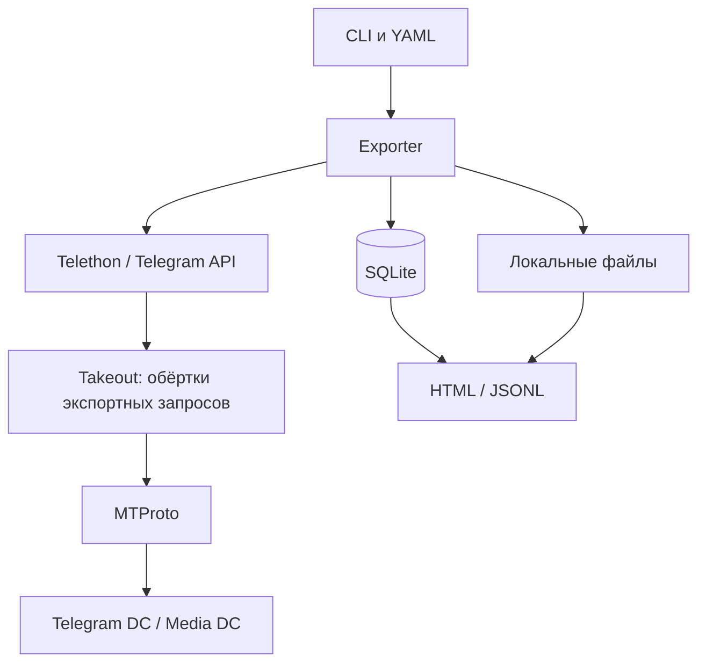
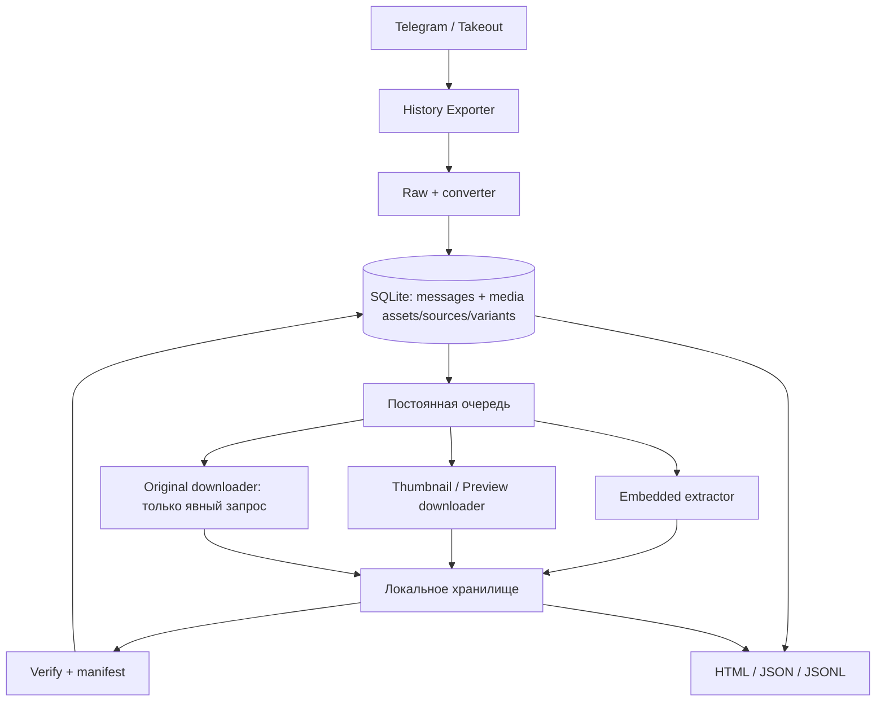
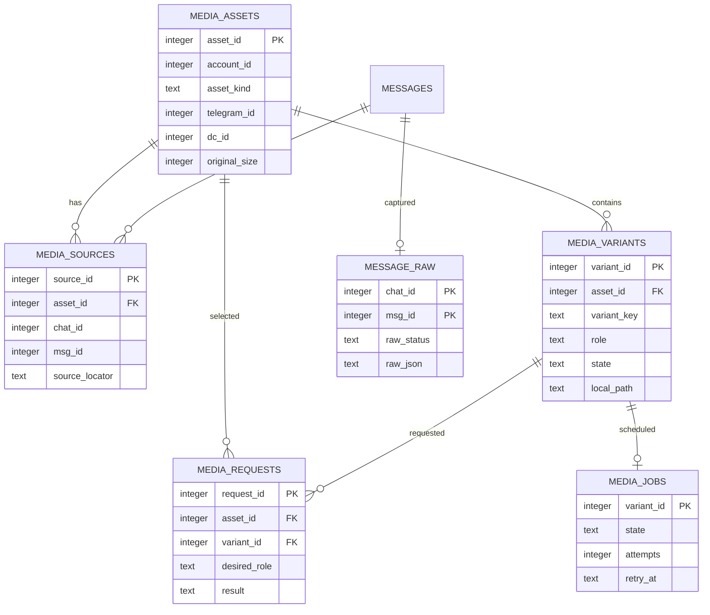
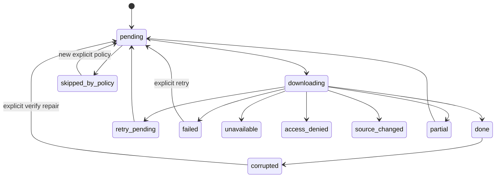

# Технический анализ VitalyOstanin/tg-export

## Проект форка для полного экспорта истории Telegram с миниатюрами

- **Рабочее название:** `tg-export-plus`
- **Версия документа:** 1.1 (редакция после аудита)
- **Дата:** 26 ноября 2026 г.
- **Статус:** техническое задание (ТЗ), проект архитектуры и план разработки; исходный проект клонирован и проверен, функции форка ещё не реализованы.
- **Upstream:** [VitalyOstanin/tg-export](https://github.com/VitalyOstanin/tg-export), коммит `8d81bc6cf95be4f04f5daa44cb38a92ead32f61b` ветки `master`.
- **Целевая аудитория:** разработчик форка, ревьюер, тестировщик, пользователь локального архиватора.

> Основная идея: сохранить всю доступную историю облачных чатов, максимально полные метаданные и визуальный контекст вложений, не скачивая полноразмерные фотографии и видео. Оригиналы должны оставаться отдельными, явно запрашиваемыми объектами. Использовать существующую инфраструктуру tg-export, а не писать новый MTProto-клиент.

**План выпуска:** E0–E4 дают ограниченный MVP для явно выбранных доступных чатов с миниатюрами, корректной диапазонной обёрткой их исторических RPC и документированным scope. Полноту истории аккаунта и профиль `full_takeout` заявлять только после E5–E6: полный поиск диалогов по диапазонам, миграции, own-only, контрольное сравнение и живые проверки. `strict_takeout` относится к RPC поддерживаемых категорий, а не является синонимом полной истории. До подтверждения файлового транспорта его включение блокируется. Решения и основания изменений перечислены в [аудите](fork-technical-design-audit.md).

## Содержание

1. [Резюме и границы исследования](#1-резюме-и-границы-исследования)
2. [Цели и требования](#2-цели-и-требования)
3. [Технический контекст](#3-технический-контекст)
4. [Анализ исходного проекта](#4-анализ-исходного-проекта)
5. [Архитектурные альтернативы и решения](#5-архитектурные-альтернативы-и-решения)
6. [Политика медиа и конфигурация](#6-политика-медиа-и-конфигурация)
7. [Алгоритм выбора и скачивания миниатюр](#7-алгоритм-выбора-и-скачивания-миниатюр)
8. [Модель данных и SQLite](#8-модель-данных-и-sqlite)
9. [Raw-метаданные и экспорт JSON](#9-raw-метаданные-и-экспорт-json)
10. [Очередь, инкрементальный экспорт и backfill](#10-очередь-инкрементальный-экспорт-и-backfill)
11. [Takeout API и полнота истории](#11-takeout-api-и-полнота-истории)
12. [CLI и пользовательские сценарии](#12-cli-и-пользовательские-сценарии)
13. [Файлы, HTML и переносимость архива](#13-файлы-html-и-переносимость-архива)
14. [Безопасность и приватность](#14-безопасность-и-приватность)
15. [Карта изменений в репозитории](#15-карта-изменений-в-репозитории)
16. [Создание форка и среда разработки](#16-создание-форка-и-среда-разработки)
17. [Дорожная карта и задачи](#17-дорожная-карта-и-задачи)
18. [Тестовые сценарии](#18-тестовые-сценарии)
19. [Критерии приёмки и контроль полноты](#19-критерии-приёмки-и-контроль-полноты)
20. [Производительность и наблюдаемость](#20-производительность-и-наблюдаемость)
21. [Миграции, выпуск и сопровождение](#21-миграции-выпуск-и-сопровождение)
22. [Риски и открытые решения](#22-риски-и-открытые-решения)
23. [Источники](#23-источники)

---

## 1. Резюме и границы исследования

### 1.1. Рекомендация

В качестве базы выбрать VitalyOstanin/tg-export: Python, Telethon, SQLite, асинхронный экспорт и существующий HTML-рендерер. Сохранить управление аккаунтами, конфигурацию, правила отбора чатов, импортер Telegram Desktop, механизмы блокировок, повторных попыток и инкрементального обхода истории. Расширить представление файлов до нескольких независимых вариантов и разделить получение истории и загрузку вложений.

Главная ошибка, которую нельзя допустить: присвоить пути к JPEG-миниатюре поле `local_path` основного видео или фото. Это приведёт к ложному статусу загрузки оригинала, конфликтам идентификаторов, неправильному воспроизведению и опасному для трафика восстановлению файлов.

### 1.2. Что проверено

После исходного исследования клонирован upstream на SHA выше: Python 3.12.14, Telethon 1.45.0 из `uv.lock`; все 1011 тестов и `scripts/check.sh` прошли, покрытие 88,79%. Подробности — в [baseline ADR](adr/000-baseline.md). Исходники Telethon и ключевые модули upstream сверены на этом коммите. Новые схемы, CLI и RPC-адаптеры остаются проектом.

**Не проверено:** работа с авторизованным тестовым аккаунтом, серверные ограничения Takeout на миниатюры, исходящие RPC на реальном sender для всех DC и поведение при истечении `file_reference`. Статический код Telethon 1.45.0 показывает обход Takeout-обёртки внутренним файловым вызовом; до теста на sender это сильный вывод из исходников, а не результат живой проверки.

Обозначения: **текущее** — обнаружено в upstream; **проект** — предлагаемая реализация; **проверить** — гипотеза/контракт, требующий проверки на фиксированном коммите. Числа лимитов и профилей форка являются проектными, а не ограничениями Telegram, если прямо не указано иное.

### 1.3. Почему не другой проект

| Инструмент | Сильная сторона | Роль в нашей разработке |
|---|---|---|
| VitalyOstanin/tg-export | Архив аккаунта, SQLite, настройки, HTML, инкрементальность | Основной upstream |
| renkagod/tg-chat-dump | Подход с разделением истории и загрузки файлов | Изучить как альтернативу для больших чатов; возможности перепроверять |
| TgWitness | Подход к проверке целостности архива | Идеи манифестов и проверки, без обязательной интеграции |
| Telegram Desktop | Официальный пример Takeout | Эталон для сравнения полноты и форматов |
| Собственный клиент с нуля | Полный контроль протокола | Не рекомендован: высокая стоимость сопровождения |

---

## 2. Цели и требования

### 2.1. Функциональные требования

| ID | Приоритет | Требование |
|---|---|---|
| FR-01 | P0/P1 | P0: выгружать историю явно выбранных доступных чатов через требуемые Takeout split ranges с записанными фильтрами и честным статусом неполноты. P1: всю доступную облачную историю выбранного аккаунта, включая Saved Messages, ботов, архивные, мигрировавшие и доступные покинутые диалоги, после полного поиска диалогов по диапазонам. |
| FR-02 | P0 | Для поддерживаемых категорий выполнять экспортные RPC через проверенный `strict_takeout` без скрытого перехода на обычный API; неподдерживаемую категорию отклонять явно. Строгий режим не означает автоматически полный охват истории. |
| FR-03 | P0 | Сохранять текст, даты, отправителей, типы чатов, ответы, пересылки, служебные сообщения, форматирование, альбомы и доступные метаданные. |
| FR-04 | P0 | Сохранять встроенные превью и серверные статические миниатюры фото и видео независимо от оригиналов. |
| FR-05 | P0 | Никогда не скачивать оригиналы по неявному fallback, при verify, импорте, повторной попытке или backfill в режиме только миниатюр. |
| FR-06 | P0 | Иметь независимые статусы оригинала и каждого варианта превью; сохранять известные размеры и идентификаторы. |
| FR-07 | P0 | Продолжать прерванный экспорт, не создавать дубликатов, не терять сообщения при сбоях медиа. |
| FR-08 | P0 | Заполнять недостающие превью уже сохранённой истории без сброса состояния чата. |
| FR-09 | P0 | По явному запросу пытаться выборочно скачивать оригиналы позже, если источник ещё доступен и совпадает по идентичности; `unavailable`/`source_changed` — допустимые исходы. |
| FR-10 | P0 | Рендерить автономный HTML с превью и понятными статусами отсутствующих оригиналов. |
| FR-11 | P0/P1 | P0: сохранять типизированный Raw TL-сообщения до нормализации и отмечать сбои до первого массового экспорта. P1: дополнить ответными `users`/`chats` и другими сущностями с явным контрактом полноты Raw. |
| FR-12 | P1 | Экспортировать переносимые JSONL и JSON; документировать схему и различия с Telegram Desktop. |
| FR-13 | P0/P1 | P0: считать полный SHA-256 каждого сохранённого варианта и восстанавливать точно этот вариант. P1: расширенный отчёт о полноте и целостности. |
| FR-14 | P1 | Расширить диапазонный Takeout до полной инвентаризации диалогов, мигрировавших групп и корректной выгрузки доступных собственных сообщений из покинутых каналов. Минимальная диапазонная обёртка для выбранных чатов входит в P0. |
| FR-15 | P1 | Опционально экспортировать профиль, контакты, истории и дополнительные данные аккаунта через отдельные политики. |
| FR-16 | P2 | Поддержать расширенные/анимированные превью, версионность сообщений, поиск, UI, экспорт совместимый с Telegram Desktop. |

P0 — ограниченный MVP выбранных чатов; P1 — обязательные функции для заявленной полноты аккаунта; P2 — расширения. `full_takeout` нельзя объявлять готовым до FR-14, покрытия отдельных категорий из §11 и соответствующих живых проверок. Режим просмотра HTML не требует доступа к сети. Строгий Takeout может работать в ограниченной области и всегда должен указывать её в manifest.

### 2.2. Нефункциональные требования

- NFR-01: совместимость старой конфигурации и базы; режим нового экспорта выбирается явно. Не изменять старые оригиналы автоматически.
- NFR-02: ограниченное потребление RAM; обработка пакетами, без загрузки всей истории в память.
- NFR-03: предсказуемая нагрузка, соблюдение FloodWait и лимитов Telegram; настраиваемая умеренная параллельность.
- NFR-04: идемпотентность записей, атомарное завершение файла, устойчивость к прерыванию и переполнению диска.
- NFR-05: защита сессий, личных данных, логов и HTML; никакой обязательной облачной инфраструктуры и телеметрии.
- NFR-06: тесты без сети по умолчанию; живые интеграционные тесты только с явно предоставленным тестовым аккаунтом.
- NFR-07: понятная диагностика прогресса, объёма, пропусков, частичных результатов и режима RPC.
- NFR-08: сохранить совместимость с принятой в upstream лицензией MIT и конвенциями разработки.

### 2.3. Что означает «полный экспорт»

Полнота относится к данным, доступным авторизованному аккаунту через поддерживаемые методы Telegram и выбранные политики. Экспорт истории и экспорт оригиналов — разные измерения полноты. Архив только с превью может быть полным по истории и неполным по бинарным вложениям намеренно.

Для каждого запуска фиксировать четыре независимых измерения: `history_scope` (выбранные/все доступные чаты и диапазоны), `history_status`, `raw_status` и `media_status` по запрошенным уровням. `strict_takeout` описывает маршрут RPC только поддержанных категорий. Значение legacy `export_state.full_history` показывает исчерпание его собственного обхода и не доказывает полноту Takeout.

Не обещать восстановление удалённых до архивации сообщений, старых редакций, секретных чатов, недоступных вложений, истории других пользователей или обход ограничений доступа, самоуничтожения, платного/защищённого контента. Отсутствующее превью не доказывает отсутствие медиа. Пропуски ID не означают потерянные сообщения. Telegram не предоставляет гарантированно атомарный снимок всего аккаунта: фиксировать время и границы обхода.

---

## 3. Технический контекст

### 3.1. Уровни взаимодействия



MTProto — протокол транспорта/защиты и обмена RPC Telegram. Telegram API — набор операций. Takeout — специализированный режим экспорта в том же API, а Telethon — библиотека Python. Takeout не возвращает одним запросом готовый архив.

### 3.2. Ключевые методы

| Метод | Роль |
|---|---|
| `account.initTakeoutSession` | Начать сессию с разрешёнными категориями данных и лимитом файлов |
| `invokeWithTakeout` | Выполнять экспортный RPC в контексте сессии |
| `messages.getSplitRanges` | Получить диапазоны истории для экспорта |
| `invokeWithMessagesRange` | Выполнить RPC в конкретном диапазоне |
| `messages.getDialogs`, `messages.getHistory` | Список диалогов и история |
| `messages.getMessages`, `channels.getMessages` | Получить/обновить конкретный исходный объект |
| `messages.search`, `channels.getLeftChannels` | Доступные собственные сообщения и покинутые каналы |
| `upload.getFile` | Получить блок файла или конкретного превью |
| `upload.getFileHashes` | Проверить серверные хеши блоков там, где применимо |
| `upload.getCdnFile` и связанные методы | Опциональный CDN-транспорт при поддержке |
| `upload.getFile` + `inputTakeoutFileLocation` | Дополнительный JSON данных аккаунта, не история целиком |
| `account.finishTakeoutSession` | Явно завершить экспорт |

### 3.3. Что нужно для скачивания

`upload.getFile(location, offset, limit, precise, cdn_supported)` использует типизированное расположение файла. Для фотографий — `InputPhotoFileLocation`, для документов/видео — `InputDocumentFileLocation`. Необходимы `id`, `access_hash`, действительный `file_reference`, правильный `thumb_size`; `dc_id` нужен для маршрутизации. `offset` и `limit` задают блоки, не размеры изображения. Правила блоков, CDN и маршрутизации см. [S12].

`thumb_size` для основного документа — пустая строка, для уменьшенной версии — конкретный код из метаданных. Для фотографии выбрать конкретный размер. Не угадывать код по расширению или разрешению. Истёкший `file_reference` обновляется повторным получением исходного объекта [S13]; сохранять источник, а не полагаться на токен как вечный URL.

---

## 4. Анализ исходного проекта

### 4.1. Что уже есть

Проект поддерживает локальное архивирование с конфигурацией на аккаунт, выбором чатов и медиа, состоянием в SQLite и HTML. В дереве присутствуют тесты, документация, lock-файл и сценарии CI. Репозиторий распространяется под MIT [S1, S2].

Существующий поток: `cli` → `config` → `api` → `exporter` → `state` / `media` → `html/renderer`. В `api.py` используется обычный клиент и активный Takeout-прокси, а `exporter.py` обходит новые и старые сообщения отдельно. `media.py` ведёт загрузки и переиспользование файлов; `verify.py` централизует восстановление. Конфигурация допускает отдельные правила для чатов, папок и типов [S2, S3, S4, S6].

### 4.2. Матрица текущих ограничений

| Участок | Текущее наблюдение | Последствие / решение |
|---|---|---|
| `TgApi.download_media` [S3] | Передаёт путь и callback; нет `thumb` | Расширить контракт конкретным вариантом, отдельно проверить RPC Takeout |
| `FileInfo` [S5] | Одна локальная ссылка и размер файла | Не подменять оригинал JPEG; добавить отдельные варианты |
| `files` [S7] | PK `(file_id, chat_id)` | Не различает варианты одного объекта. Оставить таблицу для legacy-оригиналов, добавить новую |
| `check_skip_reason` [S6] | Лимит применяется к `media.file.size` | Сначала выбрать вариант, затем проверять его размер |
| `converter.py` [S8] | Нормализует фото и документ, не переносит все исходные поля | Сохранять Raw до конвертации и каталог размеров |
| `redownload_broken_files` / `verify.py` [S9] | Восстановление через обычную загрузку медиа | Восстанавливать строго выбранный variant, уважать текущую политику |
| `exporter.py` [S4] | Двухфазный прогресс по ID и `full_history` | Смена политики не инициирует автоматический обход сохранённого диапазона; нужен backfill |
| `html/renderer.py` [S10] | `_fix_media_path` обрабатывает основной `file.local_path` | Добавить разрешение путей вариантов и безопасный fallback в UI |
| `importer.py` и reuse | Переиспользование ранее скачанных файлов | Проверять variant, а не только ID, имя, размер; импорт превью не должен помечать оригинал done |
| Каталог диалогов | `iter_dialogs` использует обычного клиента [S3] | Отделить справочные операции от экспортной выборки; для строгого профиля выполнить диапазонный обход Takeout |
| `other_data` | В документации зарезервировано [S2] | Реализовать `inputTakeoutFileLocation` как отдельную задачу |

### 4.3. Особенность Telethon

Параметр `thumb` документирован [S14]. В закреплённой Telethon 1.45.0 `_TakeoutClient.__call__` оборачивает вызовы, а внутренний `GetFileRequest` загрузчика идёт через `_client._call(sender, request)`, включая borrowed sender Media DC. По статическому коду путь минует обёртку `__call__`; `takeout.download_media()` не доказывает строгий режим. До разрешения `strict_takeout` перехватить структуру реального исходящего запроса на границе sender для основного и Media DC. Если вывод подтвердится, создать узкий адаптер транспорта без глобальной подмены `_call` и без двойной обёртки.

### 4.4. Инкрементальность и полнота

Наличие диапазона от `oldest_msg_id` до `last_msg_id` не доказывает полноту. Учитывать фильтры, архивные папки, ограничения доступа, диапазоны Takeout, ошибки и миграции. Статус `full_history` должен означать завершённый обход в заявленной области, не гарантировать наличие всех файлов и не обещать историю удалённых сообщений.

---

## 5. Архитектурные альтернативы и решения

| Вариант | Плюсы | Минусы | Выбор |
|---|---|---|---|
| A. Скрипт-компаньон читает SQLite | Быстрый прототип, мало изменений | Не интегрирует verify, HTML, историю состояния | Допустим для проверки гипотезы на маленьком чате |
| B. Расширение upstream | Совместимость, единая БД, небольшой объём изменений | Нужно учитывать все потребители файлов | Рекомендуемый путь MVP |
| C. Специализированный форк с нормализацией медиа | Максимальная гибкость, очередь, новые форматы | Больше миграций и тестов | Целевое развитие после MVP |

### 5.1. ADR — принятые проектные решения

| ADR | Решение | Обоснование |
|---|---|---|
| ADR-01 | Python/Telethon/SQLite/Jinja2 оставить | Минимизировать риски и переиспользовать инфраструктуру |
| ADR-02 | Отдельные assets/sources/variants; legacy `files` оставить | Не ломать старые архивы, однозначно различать медиа |
| ADR-03 | `embedded`, `thumbnail`, `preview`, `original` — независимые политики/уровни; физический вариант не зависит от названия профиля | Можно дозагружать качество без повторов |
| ADR-04 | Строгий запрет неявного оригинала | Главный инвариант экономии трафика |
| ADR-05 | Raw сохранить до нормализации | Избежать потери полей и повторной выгрузки |
| ADR-06 | История и файловая очередь отделены, но используют существующий процесс и lock | Сбой медиа не блокирует историю |
| ADR-07 | Источник актуализируется при необходимости | File reference временный; нельзя считать сохранённые токены бессрочными |
| ADR-08 | Takeout проверять на уровне RPC | Активная сессия сама по себе не доказывает корректность файловых запросов |
| ADR-09 | HTML строить из локальных данных | Без сети, без автоматического скачивания |
| ADR-10 | Обратная совместимость по умолчанию, новый профиль включается явно | Не менять смысл старых конфигов |



---

## 6. Политика медиа и конфигурация

### 6.1. Различия уровней

| Уровень | Источник | Типичный размер* | Сетевое скачивание | Назначение |
|---|---|---|---|---|
| `metadata` | TL-метаданные | Зависит от объекта | Нет файла | Текстовый архив |
| `embedded` | `PhotoStrippedSize` / `PhotoCachedSize` | Сотни байт — несколько КБ, cached может быть больше | Нет отдельного RPC | Мгновенное превью |
| `thumbnail` | Статический вариант из `photo.sizes` / `document.thumbs` | 3–30 КБ | Да, кроме встроенных | HTML, до 320 px по умолчанию |
| `preview` | Более качественный статический вариант; позже отдельное видеопревью | 30–150 КБ или больше | Да, кроме встроенных | До 800 px, выборочно |
| `original` | Основной документ или максимальная версия облачной фотографии | От КБ до ГБ | Да | Полный файл по запросу |

*Иллюстративные величины, не гарантия Telegram. `embedded` означает способ получения, а не фиксированное разрешение. У `PhotoCachedSize` может быть хорошее качество. `thumbnail` и `preview` используют один механизм: различаются политикой выбора. У видео нет гарантии наличия большой миниатюры. Анимированное превью не является самим видео и не обязательно является коротким фрагментом, доступным для любого ролика.

### 6.2. Рекомендуемый профиль

- Автоматически сохранять доступный `embedded`.
- Автоматически скачивать статическую миниатюру фото, видео, GIF и круглых видео до 320 px, не более 128 КиБ на вариант.
- `preview` до 800 px, 512 КиБ — только по явному выбору; анимация выключена.
- Оригиналы фотографий и видео — только по явной команде. Остальные оригиналы также выключены в безопасном по трафику профиле; голосовые и стикеры разрешаются отдельной настройкой.
- Если нет подходящего уменьшенного варианта — сохранить метаданные и встроенное превью, если оно подходит. Не скачивать оригинал для ресайза.

### 6.3. Предлагаемый YAML MVP (новый контракт, не рабочий конфиг upstream)

Пример задаёт **ограниченный** архив выбранных доступных чатов после E0–E4. Значения `raw`, `media.policy` и `takeout` до реализации отклоняются валидатором, а не молча игнорируются. Минимальная поддержка `takeout.ranges: true` обязательна уже для выбранных чатов MVP; после E5 она покрывает также полную инвентаризацию диалогов. Профиль `full_takeout` доступен только после E5–E6. Не применять этот пример к текущему upstream.

```yaml-future
output:
  path: ./export_output
  format: html

defaults:
  date_from: null
  date_to: null
  export_service_messages: true
  media:
    types: all                  # разрешённые категории для файлов
    max_file_size: 100MB        # существующий лимит оригинала, не лимит превью
    concurrent_downloads: 3
    policy:
      profile: thumbnail_archive
      embedded:
        enabled: true
        max_bytes: 131072
      thumbnail:
        enabled: true
        types: [photo, video, video_note, gif, document]
        max_dimension: 320
        max_bytes: 131072
      preview:
        enabled: false
        max_dimension: 800
        max_bytes: 524288
        animated: false
      original:
        enabled: false
        types: []
      allow_original_fallback: false
      save_all_sizes: false

raw:
  messages: true
  media: true
  encoding: typed_json_v1
  include_access_metadata: true
  include_in_public_exports: false

takeout:
  required: true
  verify_rpc_mode: true
  reuse_session: true
  ranges: true                  # MVP: обязательные split ranges для выбранных чатов

left_channels:
  action: skip                  # полное покрытие left/own-only — E5
archived:
  action: skip                  # MVP: только явно выбранные чаты
unmatched:
  action: skip                  # MVP требует явного выбора чатов
personal_info: false           # отдельный контракт RPC — E5
contacts: false                # отдельный контракт RPC — E5
sessions: false                # чувствительные данные — опционально
userpics: false
stories: false
profile_music: false
other_data: false              # отдельное осознанное включение

folders:
  Family:
    media:
      policy:
        preview:
          enabled: true
chats:
  - id: 1234567890              # условный ID, заменить реальным
    media:
      policy:
        thumbnail:
          max_dimension: 100
```

Новые поля: `media.policy`, `raw`, `takeout`. Остальные настройки повторяют общую структуру upstream, но комбинацию проверить на pinned commit. Профиль `thumbnail_archive` материализует настройки; явные поля переопределяют профиль. Вложенные переопределения должны сливаться по листовым ключам, списки заменяться целиком. Сохранить существующий порядок разрешения правил чатов и папок. Если `policy` отсутствует — старое поведение без изменения. `types: []` означает запрет сетевых загрузок по типам, а обработку уже полученных embedded отдельно определяет `embedded.enabled` в новом профиле. Все разрешения и фактический scope должны выводиться в `--dry-run`; `--require-takeout` upstream не равен `strict_takeout` форка.

Для `full_takeout` после E5 расширить диапазонный обход до всех допустимых диалогов и включать отдельные категории аккаунта только при наличии их политики и подтверждённого Takeout RPC. Если сохранённая сессия не покрывает запрошенные флаги/лимиты, запуск отклоняется или создаёт совместимую новую сессию по задокументированному протоколу. Включение `userpics`, `stories` или `profile_music` в режиме миниатюр требует отдельной variant policy и запрещено до её реализации.

### 6.4. Валидация

Числа положительные, допустимые типы сверяются с enum upstream. Пустой список — не синоним `all`. Неизвестный ключ или конфликт `allow_original_fallback: true` со строгим профилем — ошибка конфигурации. `max_bytes` хранить как целое число байт, размеры в пикселях. Для анимации установить собственные пределы времени/размера, пока они не реализованы — отклонять `animated: true`. Отдельный глобальный потолок размера Takeout согласовать с реально запрошенными файлами и протестировать на крупных родительских документах (см. §11).

Проверять совместимость всех включённых категорий с `strict_takeout` до сетевого вызова. Для неподдерживаемых `contacts`, `personal_info`, `sessions`, `userpics`, `stories`, `profile_music`, `other_data` сообщать конкретную причину отказа. Отдельно валидировать, что ни глобальные загрузки, ни verify, retry или импорт не обходят разрешение на оригинал.

---

## 7. Алгоритм выбора и скачивания миниатюр

### 7.1. Откуда брать размеры

| Объект | Статические варианты | Анимированные варианты |
|---|---|---|
| `Photo` | `sizes` | `video_sizes` |
| `Document` (video, GIF, video_note и др.) | `thumbs` | `video_thumbs` |

`PhotoSize` — сетевой вариант с известным размером. `PhotoSizeProgressive` — прогрессивный JPEG, список размеров стадий; для полного варианта оценивать максимальный размер. `PhotoCachedSize` содержит байты; `PhotoStrippedSize` требует декодирования в JPEG (Telethon `utils.stripped_photo_to_jpg`). `PhotoPathSize`, `PhotoSizeEmpty` и неизвестные типы не считать готовым JPEG. Типичные коды `s`, `m`, `x`, `y`, `w` и обрезанные `a`, `b`, `c`, `d` не гарантируют наличие или точное разрешение: использовать реальные поля `w`, `h`, `size`.

### 7.2. Инварианты выбора

1. Разобрать фактически доступные варианты, не угадывать `thumb_size`.
2. Явно определить запрещённое основное фото: исключить все сетевые варианты максимального статического разрешения и неоднозначные варианты с тем же размером; если есть только один сетевой размер фото — пропустить его. Отдельно документировать, что Telethon 1.45.0 при `thumb=None` сортирует размеры по байтам и может выбрать `VideoSize`, поэтому её неявный выбор не является безопасным правилом. Основной документ никогда не является `document.thumbs`.
3. Отфильтровать неподдерживаемые, анимированные, некорректные, превышающие лимиты или неизвестные по размеру варианты. Строго соблюдать предел и для встроенного изображения после декодирования.
4. Выбрать лучший статический вариант по площади и предсказуемым tie-break (размер, код, тип), либо выбрать все разрешённые размеры при `save_all_sizes`.
5. Сначала использовать уже сохранённый идентичный вариант. Если байты встроены — декодировать без запроса. Иначе вызвать variant-aware downloader.
6. При отсутствии результата отметить `no_thumbnail`/`skipped_by_policy`. Не вызывать `download_media(..., thumb=None)`.
7. При обновлении ссылки сверить идентичность медиа: не подменять старый файл новым после редактирования сообщения.

### 7.3. Иллюстративное ядро селектора (не production-патч)

Проверяемый консервативный селектор и точная загрузка меньшего варианта теперь реализованы в `tg_export/thumbnails.py`; синтетические TL-fixtures и sender-проверки находятся в `tests/test_thumbnails.py` и `tests/test_takeout_sender_contract.py`. Код ниже оставлен как ранний эскиз, а действующий контракт задаёт модуль: максимальные сетевые фото и неоднозначные коды исключаются, `PhotoSizeProgressive` оценивается по самой большой стадии, embedded не вызывает файловый RPC, отсутствие варианта и сетевые ошибки не переключают на оригинал. Встроенный JPEG проверяется по маркерам и размерам кадра; полное декодирование и проверка содержимого перед записью остаются задачей интеграции. Файловый вызов пока использует обычный транспорт Telethon и не является строгим Takeout (§11.3). Модуль пока не подключён к legacy экспортёру, verify и backfill; до появления policy и маршрутизации через новый путь нельзя заявлять запрет оригинала для всего запуска архива.

```python
from telethon import types

STATIC = (types.PhotoSize, types.PhotoCachedSize, types.PhotoSizeProgressive)


def size_bytes(item):
    if isinstance(item, types.PhotoCachedSize):
        return len(item.bytes)
    if isinstance(item, types.PhotoSizeProgressive):
        return max(item.sizes, default=0)
    return getattr(item, "size", 0) or 0


def select_static(sizes, *, is_photo, max_dimension=320, max_bytes=131072):
    candidates = [s for s in sizes or [] if isinstance(s, STATIC) and s.w > 0 and s.h > 0]
    # Консервативное исключение максимальной фотографии;
    # сверить с фактическим алгоритмом выбора original в Telethon.
    largest = max((s.w * s.h for s in candidates), default=0)
    candidates = [
        s
        for s in candidates
        if (not is_photo or s.w * s.h < largest)
        and max(s.w, s.h) <= max_dimension
        and 0 < size_bytes(s) <= max_bytes
    ]
    if not candidates:
        return None
    return max(candidates, key=lambda s: (s.w * s.h, size_bytes(s), s.type))
```

Селектор возвращает descriptor с исходным TL-конструктором, точным кодом `type` и метаданными, а не индекс `0/-1`: индексы могут включать не тот тип превью. Пример функции выше возвращает объект только как промежуточный результат. Для полного решения добавить идентичность embedded/cached и неоднозначных размерных кодов, поддержку нескольких медиа в одном сообщении, явные причины пропуска. Повторно проверять совпадение descriptor с исходным объектом перед загрузкой.

```python
from telethon import types, utils


def extract_embedded(size):
    if isinstance(size, types.PhotoStrippedSize):
        return utils.stripped_photo_to_jpg(size.bytes)
    if isinstance(size, types.PhotoCachedSize):
        return bytes(size.bytes)
    return None
```

Проверять формат, реальное разрешение и лимит до записи; не считать произвольные байты безопасным изображением. При повреждении embedded — статус ошибки, не запрос оригинала.

### 7.4. API-адаптер

Для legacy можно расширить `TgApi.download_media` именованным `thumb`. Для новой ветки рекомендованы отдельные `download_original()` и `download_variant()` (второй принимает только явный descriptor, запрещает `None` и original). Telethon 1.45.0 принимает объект `PhotoSize`/`PhotoCachedSize`/`PhotoStrippedSize`/`VideoSize`, но **не** объект `PhotoSizeProgressive`; локальная проверка `_get_thumb([progressive], progressive)` возвращает `None`, а вызов с точным кодом типа выбирает объект. Поэтому пример высокоуровневого вызова использует подтверждённый код размера:

```python
# Иллюстрация, выполняется только после выбора конкретного size.
assert selected_size is not None and selected_size.type
path = await active_client.download_media(message, file=str(staging_path), thumb=selected_size.type)
```

Прямой вызов для удалённой миниатюры документа:

```python
from telethon import functions, types

location = types.InputDocumentFileLocation(
    id=document.id,
    access_hash=document.access_hash,
    file_reference=document.file_reference,
    thumb_size=selected_size.type,
)
request = functions.upload.GetFileRequest(
    location=location,
    offset=0,
    limit=128 * 1024,
    cdn_supported=False,
)
# Отправить через проверенный transport в правильный Media DC.
# В строгом Takeout обернуть ровно один раз в InvokeWithTakeoutRequest.
```

Для фото используется `InputPhotoFileLocation`. Для документа `thumb_size=''` означает оригинал и запрещён в `download_variant()`. Код типа может быть неоднозначным: выбранный объект сверять с каталогом источника и полученными байтами. Один запрос не гарантирует получение всего файла. В файловом адаптере нужны пагинация блоков, контроль EOF/ожидаемого размера, DC migration, актуализация `file_reference`, обработка FloodWait и проверка ошибок. Проверять фактический объём до каждого блока и во время записи; превышение жёсткого бюджета прерывает загрузку, даже если заявленный размер неверен. Не делать прямой вызов через произвольный основной DC. Строгий транспорт опирается на библиотеку только после sender-теста; при подтверждённом обходе Takeout создать узкий адаптер. CDN вне MVP, если отказ от `cdn_supported` корректно поддерживается сервером.

### 7.5. Ошибки и безопасный fallback

| Событие | Реакция |
|---|---|
| `FILE_REFERENCE_EXPIRED` / invalid | Повторно получить исходное сообщение, найти тот же объект/размер, обновить ссылку; ограничить повторы |
| `FILE_MIGRATE_X` | Перенаправить по поддерживаемому маршруту; сохранить режим Takeout |
| `FLOOD_WAIT_X` / Premium wait | Уважать серверное время, сохранить retry_at; не использовать аккаунты для обхода лимитов |
| Timeout / временная сеть | Ограниченный backoff с jitter, затем pending/failed |
| Нет размера / нет доступа / истекло | Зафиксировать отдельную причину, перейти к следующему объекту |
| Медиа сообщения заменено | `source_changed`; искать другой легитимный источник того же объекта, не скачивать замену как старый файл |
| Неверный MIME, размер, хеш | Не помечать done; карантин или удалить staging по политике |
| ENOSPC / права / read-only | Приостановить новые файловые задачи, не терять уже сохранённую историю; при невозможности записать БД остановить экспорт |

## 8. Модель данных и SQLite

### 8.1. Эволюция схемы

В простейшем варианте можно добавить таблицу `thumbnails(chat_id, file_id, thumb_type, ...)`, оставив `files` для оригиналов. Недостатки: один `msg_id` на файл не хранит все источники; photo/document могут иметь одинаковый числовой ID; `thumb_type` не всегда однозначен; анимация и embedded потребуют новых полей. Поэтому в итоговом проекте предлагается небольшой нормализованный слой `media_assets`, `media_sources`, `media_variants`, совместимый с существующей БД. Его можно вводить поэтапно, сначала обслуживая только статические миниатюры.

Текущая архитектура использует отдельную базу на каталог экспорта. В новой схеме `account_id` всё равно сохранять явно для контроля происхождения и последующего переноса. Не объединять учётные данные разных аккаунтов. Дедупликация физического содержимого между архивами — отдельная, опциональная возможность, не основание переносить access_hash/file_reference между аккаунтами.



### 8.2. Предлагаемая DDL для первой миграции

Схема v2 уже добавлена в `tg_export/state.py` и утверждена [ADR-0009](adr/0009-versioned-media-schema.md). Показанная ниже DDL — архитектурный эскиз; действующие ограничения и статусы задаёт `MEDIA_SCHEMA_SQL`. Legacy согласование столбцов v1 остаётся прежним; новые таблицы и `user_version=2` создаются одной транзакцией. Существующая БД получает приватный SQLite backup перед переходом на v2; прежний механизм согласования столбцов после этого остаётся отдельным. Legacy `files` не переносятся автоматически: тип и полнота старого файла нельзя доказать из его строки. Идентификаторы Telegram в SQLite — signed INTEGER 64 bit. В JSON для внешних потребителей, особенно JavaScript, выдавать их как десятичные строки.

История уже пишет Raw и каталог в одном коммите с пакетами сообщений; статические миниатюры получают записи `media_jobs` со статусом `pending`. Исполнитель очереди и изменение политики загрузки ещё не включены. Курсоры фаз обновляются отдельно и при сбое могут вызвать повторное чтение пакета; UPSERT сохраняет идемпотентность. В T09 нужен checkpoint на уровне страницы, если потребуется атомарный курсор вместе с пакетом.

```sql
CREATE TABLE IF NOT EXISTS media_assets (
    asset_id INTEGER PRIMARY KEY,
    account_id INTEGER NOT NULL,
    asset_kind TEXT NOT NULL CHECK (asset_kind IN ('photo','document')),
    telegram_id INTEGER NOT NULL,
    dc_id INTEGER,
    access_hash INTEGER,
    file_reference BLOB,
    reference_captured_at TEXT,
    file_name TEXT,
    mime_type TEXT,
    original_size INTEGER CHECK (original_size IS NULL OR original_size >= 0),
    width INTEGER,
    height INTEGER,
    duration_ms INTEGER,
    raw_media_json TEXT,
    captured_at TEXT NOT NULL,
    UNIQUE (account_id, asset_kind, telegram_id),
    UNIQUE (asset_id, account_id)
);

CREATE TABLE IF NOT EXISTS media_sources (
    source_id INTEGER PRIMARY KEY,
    asset_id INTEGER NOT NULL,
    account_id INTEGER NOT NULL,
    chat_id INTEGER,
    msg_id INTEGER,
    source_kind TEXT NOT NULL,
    source_locator TEXT NOT NULL, -- canonical JSON: account-scoped peer type/id, resolver, msg_id, range if applicable
    position INTEGER NOT NULL DEFAULT 0,
    observed_at TEXT NOT NULL,
    availability TEXT NOT NULL DEFAULT 'unknown',
    CHECK ((chat_id IS NULL AND msg_id IS NULL) OR (chat_id IS NOT NULL AND msg_id IS NOT NULL)),
    FOREIGN KEY (asset_id, account_id) REFERENCES media_assets(asset_id, account_id) ON DELETE RESTRICT,
    FOREIGN KEY (chat_id, msg_id) REFERENCES messages(chat_id, msg_id) ON DELETE CASCADE,
    UNIQUE (asset_id, source_kind, source_locator, position)
);
CREATE INDEX IF NOT EXISTS idx_media_sources_msg
    ON media_sources(account_id, chat_id, msg_id);

CREATE TABLE IF NOT EXISTS media_variants (
    variant_id INTEGER PRIMARY KEY,
    asset_id INTEGER NOT NULL REFERENCES media_assets(asset_id) ON DELETE RESTRICT,
    variant_key TEXT NOT NULL,
    role TEXT NOT NULL CHECK (role IN ('original','static','animated','embedded')),
    thumb_type TEXT,
    tl_constructor TEXT,
    width INTEGER,
    height INTEGER,
    expected_size INTEGER CHECK (expected_size IS NULL OR expected_size >= 0),
    actual_size INTEGER CHECK (actual_size IS NULL OR actual_size >= 0),
    mime_type TEXT,
    local_path TEXT,
    sha256 TEXT,
    status TEXT NOT NULL DEFAULT 'available',
    origin TEXT, -- server, embedded, verified_import, legacy
    downloaded_at TEXT,
    last_error_code TEXT,
    UNIQUE (asset_id, variant_key),
    UNIQUE (variant_id, asset_id)
);
CREATE INDEX IF NOT EXISTS idx_media_variants_status
    ON media_variants(status);

CREATE TABLE IF NOT EXISTS media_requests (
    request_id INTEGER PRIMARY KEY,
    asset_id INTEGER NOT NULL REFERENCES media_assets(asset_id) ON DELETE RESTRICT,
    variant_id INTEGER,
    desired_role TEXT NOT NULL CHECK (desired_role IN ('embedded','thumbnail','preview','original')),
    requested_by TEXT NOT NULL, -- policy / explicit_fetch / verify / backfill
    policy_digest TEXT NOT NULL,
    dedupe_key TEXT NOT NULL UNIQUE,
    result TEXT NOT NULL, -- selected / no_thumbnail / skipped_by_policy / satisfied / blocked
    requested_at TEXT NOT NULL,
    updated_at TEXT NOT NULL,
    CHECK (result NOT IN ('selected','satisfied') OR variant_id IS NOT NULL),
    CHECK (result != 'no_thumbnail' OR variant_id IS NULL),
    FOREIGN KEY (variant_id, asset_id) REFERENCES media_variants(variant_id, asset_id) ON DELETE RESTRICT
);
CREATE INDEX IF NOT EXISTS idx_media_requests_asset
    ON media_requests(asset_id, desired_role, result);

CREATE TABLE IF NOT EXISTS media_jobs (
    variant_id INTEGER PRIMARY KEY REFERENCES media_variants(variant_id) ON DELETE RESTRICT,
    status TEXT NOT NULL DEFAULT 'pending',
    priority INTEGER NOT NULL DEFAULT 0,
    attempts INTEGER NOT NULL DEFAULT 0,
    retry_at TEXT,
    lease_owner TEXT,
    lease_until TEXT,
    updated_at TEXT NOT NULL,
    last_error_code TEXT
);
CREATE INDEX IF NOT EXISTS idx_media_jobs_ready
    ON media_jobs(status, retry_at, priority);

CREATE TABLE IF NOT EXISTS message_raw (
    account_id INTEGER NOT NULL,
    chat_id INTEGER NOT NULL,
    msg_id INTEGER NOT NULL,
    captured_at TEXT NOT NULL,
    api_layer INTEGER,
    telethon_version TEXT NOT NULL,
    encoding_version INTEGER NOT NULL,
    raw_status TEXT NOT NULL CHECK (raw_status IN ('saved','raw_failed')),
    raw_json TEXT,
    raw_blob BLOB,
    codec TEXT,
    raw_sha256 TEXT,
    error_code TEXT,
    PRIMARY KEY (chat_id, msg_id),
    FOREIGN KEY (chat_id, msg_id) REFERENCES messages(chat_id, msg_id) ON DELETE CASCADE,
    CHECK (
        (raw_status='saved' AND (raw_json IS NOT NULL) <> (raw_blob IS NOT NULL)
            AND error_code IS NULL)
        OR (raw_status='raw_failed' AND error_code IS NOT NULL
            AND raw_json IS NULL AND raw_blob IS NULL)
    )
);
```

`media_requests` сохраняет несколько намерений для одного варианта; `media_jobs` содержит только исполняемое состояние одного физического варианта. `no_thumbnail` записывать как результат выбора с `variant_id=NULL`, не создавать фиктивный файл. `dedupe_key` вычислять детерминированно из asset, scope, желаемого уровня, причины и digest политики; для новой явной команды создавать новый ключ запроса. Статусы запроса, задачи и физического варианта — разные словари с допустимыми переходами; перечисление и миграцию их значений утвердить до реализации. Перед каждой сетевой попыткой проверять текущую политику и наличие действующего явного запроса для оригинала, а не доверять сохранённой задаче.

Обязательные правила: включить FK на каждом writable-соединении до транзакции и проверить на временной старой БД; составной FK защищает соответствие `account_id` источника и asset, а связь `variant_id` запроса с его `asset_id` проверять транзакционно либо дополнительным ограничением. Канонизировать JSON локатора, не принимать произвольный внешний путь. `source_locator` должен хранить достаточную для повторного разрешения peer идентичность и тип RPC, но доступность peer не гарантирована навсегда. `message_raw` хранит либо типизированный payload, либо явный код сбоя; после появления ответных сущностей P1 предусмотреть отдельные таблицы snapshots.

### 8.3. Идентичность вариантов

Ключ `variant_key` стабилен независимо от профиля и имени на диске: `original`, `static:m:<тип>:<w>x<h>`, `embedded:i:<тип>:<digest>`, `animated:<код>:<тип>:...`. Это шаблоны, не готовый контракт уникальности: проверить коллизии одинаковых `type`/размеров и изменение содержимого при новых TL-наблюдениях; при необходимости добавить discriminator. `thumbnail` и `preview` — политики выбора, не разные копии одной и той же серверной миниатюры. Если два профиля выбрали один и тот же размер, хранить одну физическую версию; `role=static` и `variant_key` одинаковые. Сохранять provenance для локального переиспользования.

Для старых `files` оригиналы мигрировать только при доказуемой связи с исходным объектом и корректным типом. Если не хватает данных — `legacy_unverified`; никакого автоматического объявления миниатюры оригиналом. В переходный период определить единственный источник истины для каждой записи (legacy для не мигрированных, новая схема для мигрированных), чтобы исключить рассогласование двойной записи. Удаление источника не должно удалять физический файл, пока есть другие ссылки; очистка только явная.

### 8.4. Контракты модели Python

```python
# Эскиз, типы и имена согласовать с кодом upstream.
@dataclass(frozen=True)
class AssetKey:
    account_id: int
    kind: str
    telegram_id: int


@dataclass(frozen=True)
class VariantDescriptor:
    asset: AssetKey
    key: str
    role: str
    thumb_type: str | None
    width: int | None
    height: int | None
    expected_size: int | None
    constructor: str | None


@dataclass(frozen=True)
class DownloadIntent:
    descriptor: VariantDescriptor
    requested_by: str
    policy_digest: str
    allow_original: bool = False
```

На уровне исполнителя `DownloadIntent` валидировать перед каждой сетевой попыткой. `allow_original` в эскизе — лишь пожелание; фактическое разрешение выводится из текущего запуска и действующего `media_requests` с явным scope. Не доверять сохранённой задаче или старому `allow_original`. Дополнительные поля `source`, `actual_size`, `sha256`, `status` в DTO чтения и рендеринга. Схему сериализации моделей обновлять вместе с тестами roundtrip.

---

## 9. Raw-метаданные и экспорт JSON

### 9.1. Сохранение до конвертации

Контракт P0 Raw: на входе `convert_message` (или непосредственно перед ним) сохранить TL-объект **сообщения**, включая доступную в нём TL-медиа. `tl_message.to_dict()` содержит известные текущей Telethon поля, но не сетевой пакет, неизвестные библиотеке поля или автоматически весь ответ RPC с `users`/`chats`. Текущий upstream использует высокоуровневый `iter_messages`, выдающий отдельные сообщения; поэтому P0 не называть «полным Raw ответа». Контракт P1: захватить ответные сущности на выбранной границе RPC, сохранить их снимок с provenance и связать с сообщениями, не подменяя историческое состояние позднее разрешённой сущностью.

Ввести `message_raw` с ключом, совместимым с `messages(chat_id,msg_id)` и аккаунтом. Поля: `account_id`, `chat_id`, `msg_id`, `captured_at` (UTC), `api_layer` (если реально известен), `telethon_version`, `encoding_version`, `raw_status` (`saved`/`raw_failed`), `raw_json` (или compressed BLOB), `raw_sha256` и `error_code` при необходимости. По умолчанию хранить последнее наблюдение; версионность — отдельная функция. Нормализованное сообщение, запись `message_raw` с данными **или явным `raw_failed`**, каталог вариантов, задачи и курсор страницы сохранять одним согласованным коммитом. При сбое сериализации содержимое Raw не записывать как строку ошибки; причина фиксируется кодом, `raw_status` всего запуска становится `partial`, сообщение остаётся доступным. Перед массовым экспортом без потерь Raw можно включить опцию fail-fast.

### 9.2. Сериализация

- TL-конструктор: сохранить `_`/имя типа; поля не переименовывать без необходимости.
- `bytes`: типизированное представление `{"$type":"bytes","base64":"..."}`. Бинарные данные не переводить в произвольную UTF-8 строку.
- `datetime`: UTC ISO 8601 с явным смещением, `None` для отсутствующих дат.
- Telegram ID / access_hash: точное 64-битное представление; для внешнего JSON десятичная строка, схема определяет тип.
- Для неизвестного Python-объекта — диагностировать ошибку сериализации, а не молча `str(obj)` и не скрывать потерю данных.
- Версионировать формат. Проверить roundtrip bytes, дат, больших ID, вложенных векторов, неизвестных конструкций и null.
- Если включено сжатие, хранить codec и размер до сжатия; установить ограничения декодирования. Не внедрять внешнюю зависимость, если достаточно встроенного zlib.

Полноту Raw считать отдельно от истории по числу сохранённых, отказавших и не наблюдавшихся сообщений в заявленном scope. Не дублировать без необходимости большие бинарные поля в нескольких таблицах; первоначально простота важнее экономии нескольких КБ. Контракт публичного JSONL отдельно исключает чувствительные поля даже при сохранении их локально в Raw.

### 9.3. Переносимый JSONL

Одна запись на сообщение, UTF-8, вывод потоковый, стабильный порядок (чат, дата/ID), версия схемы в manifest. Монолитный JSON в P1 формировать потоковой записью массива либо явно ограничивать размер, не загружая всю историю в RAM. HTML и JSON не зависят от наличия действительной Telegram-сессии. По умолчанию переносимый файл не содержит `access_hash`, `file_reference` или raw аккаунта. Чувствительная выгрузка — отдельная явно включаемая опция.

```json
{
  "schema_version": 1,
  "chat_id": "-1001234567890",
  "message_id": 4242,
  "date": "2024-09-12T12:32:00Z",
  "text": "Посмотри видео",
  "media": [{
    "kind": "video",
    "telegram_file_id": "5384567890123456789",
    "original": {
      "name": "video.mp4",
      "size": 52428800,
      "status": "skipped_by_policy",
      "path": null
    },
    "variants": [{
      "key": "static:m:PhotoSize:320x180",
      "width": 320,
      "height": 180,
      "size": 18432,
      "status": "done",
      "path": "media/document/5384567890123456789/thumb_m.jpg"
    }]
  }]
}
```

Пример условный. Отдельный `manifest.json` содержит счётчики, область, версию формата, дату, статусы и относительные пути. Не называть формат совместимым с Telegram Desktop без отдельного контракта и тестовых fixtures. Экспорт больших данных через JSONL предпочтительнее монолитного JSON.

---

## 10. Очередь, инкрементальный экспорт и backfill

### 10.1. История и файлы — независимые процессы

1. Получить страницу истории; одним коммитом сохранить нормализованные сообщения, Raw или `raw_failed`, источники, каталог вариантов, результаты политики, задачи и курсор **этой страницы/диапазона**. При сбое до коммита повторить страницу, не продвигая курсор.
2. Не ждать завершения скачивания перед следующим коммитом истории. Старый `full_history` не выставлять на основании одних файловых задач.
3. Воркер получает готовую задачу и захватывает её атомарно. Не держать транзакцию SQLite во время сетевой операции.
4. Проверить текущую политику и режим, получить файл в staging, проверить формат/размер/SHA-256, атомарно переместить, зафиксировать результат.
5. Рендерить изменившиеся чаты. Состояние истории не сбрасывать при ошибках файлов.



### 10.2. Семантика статусов

| Статус | Смысл |
|---|---|
| `available` | Известный вариант, не запрошен |
| `pending` / `downloading` | Задача ожидает или выполняется |
| `done` | Полный локальный файл данного варианта успешно проверен |
| `partial` | Неполный staging; допустимо возобновление после сверки источника |
| `skipped_by_policy` | Намеренно не запрошен по настройкам |
| `no_thumbnail` | Результат выбора: подходящей миниатюры нет |
| `retry_pending` | Повтор после указанного срока |
| `reference_expired` | Нужна актуализация ссылки, переходное состояние/причина |
| `unavailable` / `access_denied` | Нет файла/доступа; не повторять бесконечно |
| `source_changed` | Исходный объект изменился, не скачивать под старым ID |
| `failed` / `corrupted` | Техническая ошибка или нарушение целостности |

Статус задачи, статус физического варианта и результат `media_requests` — разные сущности: при повторной проверке сохранённая корректная версия не обязана переходить в `downloading`. `no_thumbnail` и `skipped_by_policy` относятся к запросу/выбору, `done` и `corrupted` — к файлу, `pending` и `retry_pending` — к задаче. Для отсутствующей миниатюры записывать результат выбора на уровне политики, не искусственный файл.

### 10.3. Возобновление и аварийное восстановление

Использовать существующие process locks и атомарную запись файлов; в MVP один writer SQLite. Lease с TTL нужен при появлении параллельных процессов, либо как способ восстановить зависшую задачу; его захват должен быть условным атомарным обновлением. SQLite и файловую систему нельзя объединить одной транзакцией. При запуске выявлять устаревшие `downloading`, сопоставлять staging и конечный путь, пересчитывать размер/хеш. Если crash произошёл после rename до commit, не удалять автоматически единственную корректную копию: сверить identity и завершить запись. Если после commit обнаружен отсутствующий файл — `corrupted`/`missing`, не `done`.

Для MVP маленькие миниатюры можно скачивать заново при обрыве, не возобновляя блоки. Для оригиналов в будущем проверять точный ID, тип, вариант, ожидаемый размер и корректность offset; несовпадение — не дописывать. Обновление `file_reference` не должно подменять файл. На Ctrl+C завершать запись уже полученных данных, корректно отдавать lease и закрывать transport/DB.

### 10.4. Backfill старых архивов

- Сканировать сообщения SQLite по ключам, а не заново обходить всю историю. Использовать Raw/каталог вариантов при наличии.
- Если метаданных нет, группировать доступные message IDs по peer и получать исходные сообщения ограниченными пакетами с правильным методом и диапазоном. Для старых архивов разрешение приватного peer может потребовать сохранённого access hash или обновления каталога; одного числового ID может быть недостаточно. Отсутствие доступа — явный результат, не повод менять исходный asset.
- Сверять текущий media ID с сохранённым. Не подменять историческое вложение после изменения сообщения.
- Повторная постановка той же задачи идемпотентна. `--dry-run` показывает число кандидатов, уже сохранённых вариантов, отсутствующих метаданных, оценку трафика и недоступных источников.
- Смена `metadata` → `thumbnail`, `thumbnail` → `preview` не сбрасывает историю. Смена политики в сторону меньшего размера не удаляет прежние файлы без отдельной команды.
- Уже сохранённый оригинал не скачивать ради генерации миниатюры. При явно включённой локальной генерации помечать `origin=derived_local`; не смешивать с оригинальными серверными вариантами. Этот режим вне MVP.

---

## 11. Takeout API и полнота истории

### 11.1. Текущая и целевая реализация

Исходный `api.py` поддерживает создание/переиспользование Takeout и обычного клиента, но часть операций выполняется через обычный клиент. Методы диапазонов и дополнительного JSON не обнаружены в просмотренном API-слое. Это повод проверить полный код, а не утверждение о гарантированной неполноте любого экспорта. Официальные правила [S11] требуют оборачивать относящиеся к экспорту запросы, включая `upload.getFile`.

Ввести режимы:

- `legacy`: исходное поведение upstream, совместимость;
- `prefer_takeout`: разрешён только явно и с журналом fallback;
- `strict_takeout`: все экспортные RPC **включённых и поддерживаемых** категорий в Takeout, неподдерживаемый transport/сессия/категория — отказ до запуска либо явный partial после прерывания; обычные служебные запросы (авторизация, настройка соединения и другие необходимые операции вне экспорта) учитываются отдельно.

Не заявлять `strict_takeout`, пока не доказан файловый RPC и полный перечень обязательных экспортных методов для выбранного scope. `--require-takeout` в upstream сам по себе не является доказательством полного соответствия спецификации. `strict_takeout` может честно охватывать только выбранные чаты MVP; `full_takeout` требует дополнительно §11.4–11.5 и контроль полноты. В manifest отдельно указывать `takeout_session_active`, `media_rpc_verified`, `history_ranges_complete` и перечень исключённых категорий.

Матрица маршрутов обязательна до включения новой категории:

| Категория | Текущий upstream | Контракт нового строгого режима |
|---|---|---|
| История выбранных чатов | `_active_client.iter_messages` | `getSplitRanges`, `getHistory/getMessages` с range + Takeout; если нужен `getDialogs`, также range + Takeout |
| Обычные вложения | `_active_client.download_media` | Доказанный `InvokeWithTakeout(GetFile)` и выбранный variant |
| Repair и повтор | `verify.py` повторно вызывает `download_media` | Тот же variant и тот же доказанный транспорт |
| Профиль, контакты, сессии | часть вызовов через обычный `self.client` | Отклонить в MVP, пока экспортные методы не переведены и не проверены |
| Фото профиля, stories, музыка | отдельный `_download_batch` через обычный клиент | Отклонить в MVP, пока нет variant policy и доказанного транспорта |
| Прямые команды `tg` | отдельные обычные операции пользователя | Не считать частью архивного strict scope; запретить запись в состояние strict архива без явного контракта |

### 11.2. Сессия и флаги

При инициализации согласовать `contacts`, `message_users`, `message_chats`, `message_megagroups`, `message_channels`, `files` и `file_max_size` с выбранными данными. Нельзя автоматически переиспользовать старую сессию, если её возможности не покрывают новый план. Хранить локальный digest флагов/лимита (не сам auth_key); сессия неизвестного происхождения требует проверки. Обрабатывать серверный cooldown; не создавать бесконечно новые сессии. При завершении экспорта явный `finishTakeoutSession(success=...)`, при паузе — осознанное сохранение действующей сессии в соответствии с правилами API и существующей логикой upstream. Не объявлять успех при неполном обходе.

Открытая проверка: серверный `file_max_size` может учитывать родительский объект, а не только запрашиваемое превью. Протестировать видео намного больше лимита превью, запросив разрешённый серверный размер. При необходимости выбирать совместимый с сервером предел сессии, сохраняя собственный жёсткий запрет оригинала и предел каждого блока. Если сервер отказывает — сообщать, а не скрывать fallback.

### 11.3. Проверка файлового транспорта

- Для закреплённой Telethon 1.45.0 обход `_TakeoutClient.__call__` внутренним `_client._call` подтверждён sender-тестом для основного и Media DC, включая `FILE_MIGRATE` и вызов `download_media` с миниатюрой. Карта маршрутов, тестовый контракт и решение — в [T02/T08](takeout-rpc-inventory.md).
- На тестовом стенде перехватить запрос на границе sender: assert внутренний `GetFileRequest` и внешний `InvokeWithTakeoutRequest` с ожидаемым ID; проверить обычный DC, миграцию в Media DC и повтор после устаревшего reference.
- Если встроенная загрузка не оборачивает запрос — сделать локальный transport adapter, не менять глобально поведение всех API-вызовов. Не выполнять двойное оборачивание. CDN поддерживать только после корректных тестов расшифровки и хешей; в MVP не заявлять CDN, если не реализован.
- В метриках фиксировать количество RPC по режимам, не выводить ключи авторизации, токены или payload с данными.

### 11.4. Диапазоны и выборка

```text
init / resume Takeout
  obtain self ID
  getSplitRanges inside Takeout
  for each required range:
    getDialogs pagination (range wrapper -> takeout wrapper)
    for each eligible peer:
      getHistory pagination using same range
      store results, checkpoint and observed scope
  export applicable own messages and migrated groups
  reconcile counts / errors / boundaries
  finish or explicitly pause
```

Это концептуальный алгоритм полного P1-обхода. В P0 список выбранных peer задаётся конфигурацией/каталогом, но `messages.getSplitRanges` и `invokeWithMessagesRange` для `getHistory`/`getMessages` обязательны уже тогда; `getDialogs` применяет диапазоны, если выполняется как экспортный запрос. Порядок и исключения для публичных супергрупп/каналов реализовать по актуальной спецификации [S11]. Не использовать одинаковый курсор между разными диапазонами. Хранить checkpoint `(account, peer, range, phase, filter fingerprint)` с устойчивым курсором. Объединять результаты по стабильному ключу сообщения. При миграции старой группы сохранить оба peer ID и relation `migrated_to`, а в отчёте и HTML не удваивать историю. Не считать покинутый канал обычным доступным каналом — экспортировать только возвращаемые сервером данные, при необходимости собственные сообщения через `messages.search(from_id=self)` согласно спецификации. Сохранять область `own_only` вместо ложного `full_history`.

Матрица `full_takeout` должна отдельно покрывать: обычные и архивные диалоги, диапазоны по типам чатов, миграции, own-only после потери доступа, сообщения в темах форума, разрешение custom emoji документов и сообщения без доступных вложений. Для каждой категории фиксировать `supported`/`partial`/`excluded` и тесты. Отсутствие поддержки одной категории не скрывать за общим `complete`.

### 11.5. Данные аккаунта

Дополнительные категории — профиль, контакты, фото профиля, истории, мелодии, активные сессии и `inputTakeoutFileLocation`. Включать отдельно от истории после определения Takeout RPC, политики размеров, статуса и режима публикации для каждой категории. Официальный Takeout для сохранённых контактов описывает `contacts.getSaved`; текущий `get_contacts` upstream вызывает иной метод через обычный клиент и не выполняет этот контракт автоматически. Для `other_data` выполнить `GetFileRequest(InputTakeoutFileLocation(), ...)` внутри Takeout, обработать `TAKEOUT_FILE_EMPTY` как пустой результат, сохранить исходный JSON/байты и manifest. Это не выгрузка всей переписки одним запросом. Не включать чувствительные сведения о сессиях и профиле в публичный HTML автоматически.

---

## 12. CLI и пользовательские сценарии

### 12.1. Существующие команды — проверять по pinned upstream

```bash
uv run tg-export --help
uv run tg-export run --help
uv run tg-export run --dry-run
uv run tg-export run --require-takeout
uv run tg-export state show --help
```

Изучить текущий CLI и расположение глобальных флагов; не переносить предположения о синтаксисе на новый релиз без теста. Текущий проект позволяет работать с конкретным сообщением через группу `tg` (см. [S17]), но это не обязательно обновляет состояние нашего будущего архива.

### 12.2. Проект новых команд (не реализованы)

| Команда | Назначение |
|---|---|
| `run --profile thumbnail_archive` | Экспорт истории + embedded + миниатюры |
| `run --takeout-mode strict` | Новый режим RPC только после проверки всех включённых категорий; не синоним `--require-takeout` upstream |
| `media stats` | Статистика файлов, вариантов, очереди, трафика |
| `media list` | Поиск по чату, дате, типу, статусу |
| `media backfill --variant thumbnail` | Заполнение недостающих вариантов из сохранённой истории |
| `media fetch --variant preview` | Повышение качества по выбранным сообщениям |
| `media fetch --variant original` | Явная загрузка оригиналов с проверкой лимитов |
| `media verify --variant thumbnail` | Локальная проверка; сеть только с `--repair` |
| `media retry` | Повтор неудачных задач с сохранением исходного варианта |
| `media prune` | Явная очистка выбранных локальных вариантов |
| `export jsonl` | Потоковая выгрузка данных |
| `export manifest` | Отчёт о полноте и проверяемости архива |

Предлагаемый синтаксис:

```bash
# Первый экспорт выбранных чатов после завершения и проверки MVP
uv run tg-export run --profile thumbnail_archive --takeout-mode strict

# Старый архив: сначала оценка, затем загрузка миниатюр
uv run tg-export media backfill --variant thumbnail --dry-run
uv run tg-export media backfill --variant thumbnail --takeout-mode strict

# Качественное превью конкретного сообщения
uv run tg-export media fetch --chat 1234567890 --message 4242 --variant preview --takeout-mode strict

# Оригинал конкретного сообщения: явный выбор пользователя
uv run tg-export media fetch --chat 1234567890 --message 4242 --variant original --takeout-mode strict

# Массовая выборка оригиналов: проверить объём до начала
uv run tg-export media fetch --chat 1234567890 --from 2024-01-01 \
  --to 2024-12-31 --types photo,video --variant original --dry-run

# Проверка без сети и явное восстановление превью
uv run tg-export media verify --variant thumbnail
uv run tg-export media verify --variant thumbnail --repair --takeout-mode strict

uv run tg-export media stats --json
uv run tg-export export jsonl --output ./messages.jsonl
```

`--takeout-mode strict` и все команды этого блока — проект нового CLI, не существующий синтаксис upstream. Пока sender-тест не пройден, строгий режим должен отказывать до сетевой работы. `--variant thumbnail|preview` задаёт профиль выбора; `--variant-key` — точный ранее зарегистрированный вариант для verify/retry. `--chat` и `--message` должны однозначно разрешаться в области одного аккаунта; даты интерпретируются в документированной зоне, верхняя граница — явная (например, следующий день исключён). `--dry-run` не скачивает файлы, не изменяет историю и не запускает новую Takeout-сессию без необходимости; если нужна сеть для уточнения метаданных, явно сообщить. Команды массовой загрузки/удаления требуют явного scope, показывают оценку и требуют подтверждения или `--yes` для unattended. Не позволять `media retry` превращаться в неявное скачивание оригиналов. `--repair` восстанавливает тот же точный вариант, только при действующем разрешении.

### 12.3. Режим без доработки

Для исходного проекта использовать отдельный per-account конфиг с `defaults.media.types: []`, `date_from: null`, `date_to: null`, `export_service_messages: true`, действиями `export_with_defaults` для unmatched/archived/left_channels. Отключить `userpics`, `stories`, `profile_music`, если не нужны отдельные медиа. Не оставлять правила чатов, которые повторно включают оригиналы. Сверить `--dry-run` и поведение парсера конкретного релиза. Этот режим не сохраняет новые серверные миниатюры; Raw может быть неполным. Предпочтительно не выполнять первый огромный экспорт до появления Raw и корректного каталога вариантов.

## 13. Файлы, HTML и переносимость архива

### 13.1. Структура

Предлагаемая логическая структура (сохранить текущие пути upstream для существующих файлов; новые варианты размещать в отдельном пространстве имён):

```text
export_output/<account>/
  <existing-state.sqlite>      # существующая база состояния
  index.html
  chats/                      # существующий layout уточнить при интеграции
    <chat>/
      messages.html
  media_variants/
    photo/<telegram_id>/
      embedded_i.jpg
      thumb_m_320x240.jpg
    document/<telegram_id>/
      thumb_m_320x180.jpg
      preview_x_800x450.jpg
      original.mp4            # только если явно запрошен
  manifest.json
  messages.jsonl              # опционально
  .staging/                   # не включать в HTML/JSON
```

Имя должно включать стабильный идентификатор варианта либо безопасный digest; не использовать непроверенное имя файла из Telegram как путь. Пути в новой таблице относительны корня архива. Не сохранять абсолютные ссылки на соседний аккаунт как единственный способ доступа; при необходимости переносимого экспорта копировать/линковать файлы внутри разрешённого корня. При переносе HTML, JSONL и SQLite должны оставаться согласованными.

### 13.2. HTML

Изменить DTO и `_fix_media_path()` так, чтобы он разрешал путь каждого варианта. Рендерер подбирает самый качественный уже сохранённый статический вариант, не выполняя сетевых операций. Видео без оригинала — `` с длительностью и подписью, не `<video src="thumb.jpg">`. При наличии оригинала — отдельный локальный элемент воспроизведения или ссылка; миниатюра может стать poster. Изображение без превью — доступный оригинал только если он уже существует; иначе placeholder. Приоритет: качественное статическое превью → миниатюра → embedded → placeholder (или существующий оригинал, если разрешено отображение).

```html
<figure class="archived-media">
  
  <figcaption>video.mp4 · 50 МБ · 02:00</figcaption>
  <span>Оригинал не скачан</span>
</figure>
```

Это макет, не готовый шаблон. Показывать оригинальный размер, длительность, разрешение, статус, ошибки по запросу. При наличии разрешённого формата ссылки на исходное сообщение добавить явную ссылку Telegram; не обещать её для любого личного чата. Не раскрывать `access_hash` и `file_reference` в HTML. Существующий offline renderer и `--rerender` адаптировать; backfill помечает затронутые месяцы/чаты dirty. При больших архивах не собирать все сообщения в один DOM и не внедрять thumbnails в base64 HTML по умолчанию.

### 13.3. Целостность и очистка

Файл сначала записывается в staging на том же томе. Проверить лимит байтов во время скачивания, а не только после. Сверить размер при его достоверности, MIME/сигнатуру и разрешение изображения, вычислить полный SHA-256 потоково, атомарно переместить. Локальный SHA-256 помогает обнаруживать порчу и дубликаты, но сам по себе не доказывает подлинность отправителя. Серверные хеши проверять отдельно, когда метод применим.

`verify` по умолчанию выполняется офлайн, repair отдельно. При очистке сначала dry-run, учитывать все ссылки и lock, не удалять legacy-файлы неизвестного назначения, staging и новые варианты обрабатывать по отдельным правилам. Никогда не удалять источник истории при удалении бинарного варианта. Удаление архива или prune должно быть явным.

---

## 14. Безопасность и приватность

- Только собственный/разрешённый аккаунт, в рамках прав доступа и правил Telegram; уважать ограничения на экспорт, TTL, paid media, protected content. Не обходить их.
- Сессии Telethon фактически позволяют действовать от имени пользователя. Хранить `.session`, API credentials, пароли и токены вне репозитория и вне экспортируемых документов, с ограниченными правами доступа. Не загружать их в CI, сторонние сервисы и логи.
- Raw содержит личные данные и потенциально чувствительные метаданные доступа. Хранить локально, с защитой диска и резервных копий; минимизировать включение в переносимый экспорт. Не публиковать архив в открытом репозитории.
- HTML строить с autoescape, безопасной обработкой URL (разрешённые схемы), без выполнения кода из сообщения и без внешних сетевых зависимостей. Не открывать архивные активные файлы автоматически; проверять MIME и использовать отдельную загрузку опасных типов.
- Защита от path traversal, симлинков, подмены целевого каталога, опасных имён и коллизий. Все операции удаления/записи ограничить корнем аккаунта. Обработку изображений ограничить по байтам и числу пикселей; учитывать decompression bomb.
- Логи — только служебные коды/счётчики, при необходимости редактировать идентификаторы. Никогда не логировать auth_key, file_reference, токены и тексты переписки в обычном режиме.
- Тестовые данные — синтетические TL fixtures; живые проверки только собственным отдельным тестовым аккаунтом и контрольными сообщениями. Никаких реальных архивов в git.
- Не использовать несколько аккаунтов или сессий для обхода FloodWait. При ограничении — ждать указанный сервером срок или остановить с сохранением состояния.

---

## 15. Карта изменений в репозитории

```text
tg_export/
  api.py                 # изменить: явные варианты и Takeout RPC
  config.py              # изменить: policy, валидация, merge
  models.py              # изменить: DTO и состояния вариантов
  converter.py           # изменить: каталог вариантов, hook raw
  exporter.py            # изменить: atomic history commit, очередь
  state.py               # изменить: additive migration, DAO
  media.py               # изменить: reuse, staging, variant-aware download
  importer.py            # изменить: безопасное соответствие вариантов
  verify.py              # изменить: verify/repair точного варианта
  thumbnails.py          # новый: селектор и embedded
  media_queue.py         # новый: задачи, lease, retry, backfill
  raw.py                 # новый: типизированный сериализатор
  takeout_ranges.py      # новый: диапазонная пагинация (P1)
  media_transport.py     # новый при необходимости: строгий RPC adapter
  cli/
    media.py             # новый: stats/list/backfill/fetch/verify/retry/prune
  html/
    renderer.py          # изменить: paths / DTO
    templates/           # изменить: preview + status
  ...
tests/
  test_thumbnails.py     # новый
  test_media_variants.py # новый
  test_media_queue.py    # новый
  test_raw.py            # новый
  test_takeout_ranges.py # новый
  test_takeout_transport.py # новый
  ...                    # расширить существующие тесты
config.example.yaml      # расширить и синхронизировать с docs
pyproject.toml           # coverage floors и зависимости при необходимости
uv.lock                  # обновлять только осознанно
docs/
  configuration.md
  cli.md
  adr/                   # зафиксировать решения
  fork-technical-design.md
  archive-schema.md
  migration.md
```

Разделение модулей — предложение, не утверждение о фактических именах новых файлов. Учитывать конвенции upstream по тестам, фикстурам и проверкам стиля. Для маленького MVP часть DAO допустимо оставить в `state.py`, если интерфейс не разрастается. Не переписывать всё одним коммитом.

### 15.1. Аудит всех потребителей legacy `files`

До внесения изменений выполнить поиск `get_file`, `download_media`, `local_path`, `sha256_head`, `check_skip_reason`, `files`, `full_history` по пакету и тестам. Составить список мест записи, чтения, переиспользования, удаления и рендеринга. В каждом решить: legacy-ветка, variant-aware ветка или общий интерфейс. Особенно проверить восстановление, импорт Telegram Desktop, дедупликацию соседних аккаунтов, cleanup orphaned files, каталоги глобальных данных, экспорт альбомов, повторный запуск после прерывания.

---

## 16. Создание форка и среда разработки

### 16.1. Зафиксировать исходную версию

Локальный upstream уже клонирован на указанном SHA, ветка `feature/media-variants` создана, baseline записан в `docs/adr/000-baseline.md`. Удалённый GitHub fork ещё не создавался. При подготовке публикации создать его через интерфейс GitHub (или `gh repo fork` при установленном и авторизованном GitHub CLI), затем подключить отдельным `origin`, сохранив исходный репозиторий как `upstream`. Для новой копии после создания fork, заменив `<OWNER>` своим именем:

```bash
git clone https://github.com/<OWNER>/tg-export.git
cd tg-export
git remote add upstream https://github.com/VitalyOstanin/tg-export.git
git fetch upstream
git switch master
git rev-parse upstream/master
git status --short
git switch -c feature/media-variants upstream/master
```

Сохранить фактический SHA, дату, `pyproject.toml`, `uv.lock`, версию Telethon и Python в `docs/adr/000-baseline.md` — выполнено для текущего checkout. Избегать разработки прямо в ветке master; поддерживать чистую upstream tracking branch. Сохранить LICENSE, copyright и attribution. Рабочее имя `tg-export-plus` пока не требует переименования пакета; для отдельной установки позже согласовать имя дистрибутива, CLI, директорию конфигурации, версию и конфликт с upstream.

### 16.2. Базовые проверки

Согласно CONTRIBUTING [S2], используется `uv` и единый скрипт проверок:

```bash
uv sync
uv run tg-export --help
uv run python -m pytest
scripts/check.sh
```

Для частичного запуска:

```bash
uv run python -m pytest tests/test_models.py --no-cov
uv run ruff check .
uv run ruff format --check .
uv run pyright
```

Набор CI, Python и coverage floor на зафиксированном SHA проверены: 1011 тестов, покрытие 88,79%, полный `scripts/check.sh` прошёл. Детали среды и исходного сбоя прав доступа — в baseline ADR. Новые модули зарегистрировать в проверках покрытия согласно CONTRIBUTING. При изменении примера YAML синхронизировать с документацией, поскольку upstream может проверять их совпадение.

### 16.3. Первые задачи аудита (до изменения кода)

```bash
git grep -n -E 'download_media|check_skip_reason|_fix_media_path|redownload_broken_files' -- tg_export tests
git grep -n -E 'GetSplitRanges|InvokeWithMessagesRange|InputTakeoutFileLocation' -- tg_export tests
git grep -n -E 'file_reference|access_hash|sha256_head|full_history' -- tg_export tests
```

Создать синтетический fixture фото с 3 размерами и видео 2 ГБ с маленьким thumb. Сформировать старую тестовую БД с legacy files. Получить исходный HTML golden snapshot. Определить интеграционную точку raw capture, момент commit и реальный контракт вызова Telethon. Не авторизовывать личный аккаунт для unit tests.

---

## 17. Дорожная карта и задачи

Оценки в человеко-днях (ч-д) — ориентиры для одного разработчика, знакомого с Python/SQLite; не календарное обещание. Параллельность задач возможна после фиксации контрактов. Живые проверки зависят от доступа к тестовому аккаунту и серверной задержки Takeout. Уточнить оценки после E0.

| Этап | Результат | Зависимости | Оценка, ч-д |
|---|---|---|---:|
| E0 | Pinned baseline, аудит всех RPC/загрузок, sender-тест Telethon, решение о строгом транспорте и scope MVP | — | 1–3 |
| E1 | Политики, каталог размеров, селектор, контракт/сериализатор Raw | E0 | 3–5 |
| E2 | Версионированная SQLite schema, Raw capture, минимальный downloader, проверенный строгий transport | E1 | 4–8 |
| E3 | Диапазонный обход выбранных чатов, history/queue, HTML, verify и совместимость | E2 | 4–8 |
| E4 | CLI backfill/fetch, повторные загрузки, миграции | E3 | 3–6 |
| E5 | Полная инвентаризация диалогов по диапазонам, миграции/own-only, матрица истории, выбранные данные аккаунта, JSONL | E2–E4 | 5–10 |
| E6 | Нагрузочные и живые проверки, документация, release | E1–E5 | 3–6 |

**MVP-кандидат** — E0–E4 для выбранных доступных чатов с документированными исключениями; `strict_takeout` допустим только для проверенного набора включённых категорий. **Целевой релиз `full_takeout`** — после E5–E6 и живого сравнения полноты. Отдельный прототип embedded можно выпустить после E1, не обещая полную медиафункциональность. Raw P0 должен быть готов до первого массового экспорта. Оценки пересмотреть после sender-теста и проектирования миграции.

### 17.1. Backlog для GitHub Issues

| ID | Задача / ожидаемый deliverable | Приоритет | Зависит от |
|---|---|---|---|
| T01 | Зафиксировать SHA, Python, Telethon; baseline test report | P0 | — |
| T02 | Инвентаризация всех экспортных RPC/загрузок, legacy schema, fixtures, контракт sender | P0 | T01 |
| T03 | Policy dataclasses, merge, validation, dry-run output | P0 | T02 |
| T04 | Селектор TL размеров и декодирование embedded; тест исключения original | P0 | T02 |
| T05 | Версионированная schema assets/sources/variants/requests/jobs + безопасная миграция legacy | P0 | T02 |
| T06 | Raw serializer и согласованная запись raw или raw_failed, catalog, message, cursor | P0 | T02,T05 |
| T07 | Variant downloader, staging, SHA-256, проверка лимита и file reference | P0 | T03–T05,T08 |
| T08 | Ранний sender contract Takeout/Media DC; при необходимости адаптер и повторные тесты | P0, блокирует strict | T01,T02 |
| T09 | Постоянная очередь, retry/leases, split ranges и курсоры истории выбранных чатов | P0 | T05–T08 |
| T10 | HTML preview DTO, paths, templates, rerender | P0 | T05,T07 |
| T11 | Verify/import/reuse/cleanup без подмены вариантов | P0 | T07,T09 |
| T12 | CLI media stats/list/backfill/fetch/verify/retry | P0 | T09–T11 |
| T13 | Legacy migration, конфиги, тесты upgrade/recovery | P0 | T05,T11,T12 |
| T14 | Полный поиск диалогов по split ranges, migration, archived/left own-only, forum topics/custom emoji scope | P1 | T08,T09 |
| T15 | `inputTakeoutFileLocation`, профили account data, manifest | P1 | T08,T14 |
| T16 | JSONL и JSON, versioned schema, private/public modes | P1 | T06,T10 |
| T17 | MVP: негативные RPC, нагрузка и security review; P1: сравнение полноты с Desktop | P0/P1 | P0: T12,T13; P1: T14–T16 |
| T18 | Документация, CI, changelog, release, upgrade guide по каждому scope | P0/P1 | соответствующая часть T17 |
| T19 | Animated preview, revisions, UI (optional) | P2 | T18 |

### 17.2. Рекомендуемый порядок pull requests

1. ADR + fixtures + baseline + sender-тест, матрица экспортных RPC (без изменения поведения).
2. Policy и selector (чистые функции, backward compatibility).
3. Версионированная SQLite schema, media_requests и Raw capture (миграция и тесты).
4. Проверенный transport/download variants, strict guard, embedded extractor.
5. Очередь, backfill, verify/import/reuse; атомарность.
6. HTML, CLI, документация и миграции.
7. Расширенный Takeout и manifest/JSONL.
8. Release hardening и проверка всех тестов.

Каждый PR должен быть самостоятельно проверяемым. В описание включить изменение поведения, схему миграции, риски и результаты тестов; не публиковать пользовательские данные. Ветки `feature/*` или `fix/*`; формат commit и требования ревью — по CONTRIBUTING upstream.

---

## 18. Тестовые сценарии

### 18.1. Unit / property tests

| ID | Сценарий | Ожидаемый результат |
|---|---|---|
| U01 | Фото `s`, `m`, `x`, `y`, лимит 320 | Выбран лучший допустимый меньший размер |
| U02 | Фото с единственной сетевой версией | Строгий профиль не скачивает её как thumb |
| U03 | Фото с двумя максимальными версиями одного разрешения | Неоднозначные основные варианты исключены |
| U04 | Наличие только PhotoStrippedSize | Валидное embedded JPEG, ноль файловых RPC |
| U05 | PhotoCachedSize с данными | Используются встроенные байты при допустимом размере |
| U06 | PhotoSizeProgressive с несколькими стадиями | Учитывается максимальный размер; передача объекта в Telethon 1.45.0 не используется, точный код/низкоуровневый descriptor выбирает тот же вариант |
| U07 | Пустой список, PhotoSizeEmpty/PhotoPathSize | Не происходит загрузка, корректная причина |
| U08 | VideoSize в списке и `animated=false` | Выбирается только статический вариант |
| U09 | Видео 2 ГБ, thumb 20 КБ | Лимит оригинала не блокирует миниатюру |
| U10 | Превью больше лимита/неизвестного размера | Отклонено до загрузки либо по жёсткому бюджету |
| U11 | Два профиля выбирают один `PhotoSize` | Одна физическая версия, тот же variant key |
| U12 | Photo ID совпадает с Document ID | Разные assets |
| U13 | Один файл в двух сообщениях и чатах | Несколько sources, один variant в рамках аккаунта |
| U14 | Разные аккаунты, одинаковый ID | Ссылки доступа не переиспользуются между аккаунтами |
| U15 | Raw bytes/datetime/64-bit/null/nested | Точный roundtrip, schema_version |
| U16 | Raw serialization error | Явный raw_failed, сообщение не исчезает |
| U17 | Старый YAML без policy | Legacy-поведение сохранено |
| U18 | Merge folder/chat/profile, пустые списки | Ожидаемый приоритет, запреты не потеряны |
| U19 | `thumb=None` в variant downloader | Запрет до любого RPC |
| U20 | Неверный MIME/размер/изображение | Не помечается done |
| U21 | Строгий профиль + конфликт original fallback | Ошибка конфигурации |
| U22 | Путь `../../...` или имя с разделителем | Не выходит за корень архива |
| U23 | Источник удалён/редактирован | Не подменяется сохранённый asset |
| U24 | Несколько вложений/альбом | Стабильные связи и правильный position |
| U25 | Два запроса на один variant: policy и explicit_fetch | Одна исполняемая задача, оба намерения сохранены; старое разрешение не даёт загрузить original в новом запуске |
| U26 | Нет допустимого thumb | `media_requests.result=no_thumbnail`, фиктивного `media_variants` нет |
| U27 | Raw ошибка после нормализации | В одном коммите есть сообщение и `raw_failed`; курсор не скрывает неполноту Raw |

### 18.2. Integration / persistence tests (без живого Telegram)

| ID | Сценарий | Ожидаемый результат |
|---|---|---|
| I01 | Экспорт страницы с медиа; воркер падает | Сообщения и очередь сохранены, история продолжается |
| I02 | Повтор того же экспорта | Без повторной загрузки и дублей |
| I03 | metadata → thumbnail | Backfill старых сообщений без reset истории |
| I04 | thumbnail → preview → original (явно) | Каждый вариант независим, прошлые не перезаписаны |
| I05 | thumbnail policy после ранее поставленных original jobs | Оригиналы не запускаются неявно |
| I06 | `FILE_REFERENCE_EXPIRED`, тот же asset | Обновление источника и повтор того же размера |
| I07 | Истёкший reference, файл заменён | source_changed, старый asset не подменён |
| I08 | FILE_MIGRATE → Media DC | Корректный transport и Takeout wrapper |
| I09 | FloodWait / временная сеть | Сохранён retry_at, без превышения лимитов |
| I10 | Ctrl+C, crash до commit history | Страница безопасно повторяется |
| I11 | Crash после rename до DB commit | Reconciliation, нет потери файла/ложного done |
| I12 | Disk full / read-only | Предсказуемая остановка файловой очереди и диагностика |
| I13 | Повреждённая миниатюра, repair | Скачивается точно thumb, не original |
| I14 | Legacy оригинал без миниатюр | Миграция сохраняет файл и не меняет статус оригинала |
| I15 | Импорт thumbnail из Desktop | Не регистрируется как original без подтверждения |
| I16 | Очистка файла с несколькими источниками | Нет удаления используемого другим сообщением |
| I17 | HTML video without original | ``/poster, нет ссылки на несуществующий MP4 |
| I18 | HTML XSS, URL, dangerous filename | Escaping и безопасные пути |
| I19 | Перенос архива в другой каталог | Относительные ссылки работают офлайн |
| I20 | Два процесса на одной БД/сессии | Lock/lease исключает конфликт |
| I21 | JSONL большого архива | Потоковый вывод, точные ID, schema version, нет секретов по умолчанию |
| I22 | Миграция из старой БД + откат через backup | Количество сообщений и файлы сохранены |
| I23 | Пропущенный диапазон/ошибка пагинации | Scope partial, не ложный full_history |
| I24 | Несколько split ranges, повтор ID | Нет дублей, независимые курсоры |
| I25 | Старый чат → супергруппа | Сохраняются оба peer, migration relation |
| I26 | Покинутый канал, доступно только own-only | Чёткая область, не попытка обхода |
| I27 | Strict Takeout недоступен | Явная остановка/partial, нет тихого fallback |
| I28 | Файловые RPC на границе sender | Правильное одно оборачивание InvokeWithTakeout |
| I29 | Сессия с несовместимыми флагами | Не переиспользуется молча; диагностика |
| I30 | `TAKEOUT_FILE_EMPTY` | Отмечается отсутствие данных, не ошибка всего экспорта |
| I31 | Сбой миграции между DDL и переносом legacy | Восстановление из backup или безопасный повтор; версия схемы не объявлена завершённой |
| I32 | Открытие БД с FK и source другого аккаунта | Несоответствие отклонено, `foreign_key_check` чист |
| I33 | Контакты/profile при строгом MVP | Конфигурация отвергнута до сетевого вызова; обычных экспортных RPC нет |
| I34 | Фото профиля/stories и прямой глобальный downloader | В профиле только миниатюр неподдержанная категория заблокирована до возможной загрузки оригинала |
| I35 | Падение после записи страницы до курсора | Сообщение, Raw, каталог, задачи и курсор повторяются как одна транзакция |
| I36 | Форумные темы, custom emoji, migrated peer в full_takeout | Заявленный scope соблюдён; архив и отчёт не удваивают сообщения |

### 18.3. Живые проверки (явный opt-in)

На небольшом тестовом аккаунте создать контрольный диалог с фото разных разрешений, видео, GIF, круглым видео, альбомом, ответом, пересылкой, форматированием, служебным сообщением, документом, голосовым и стикером. При возможности включить доступные архивные и мигрировавшие группы. Не проводить destructive tests на личной переписке.

| ID | Проверка | Критерий |
|---|---|---|
| L01 | Takeout history | Контрольные сообщения найдены, RPC mode подтверждён |
| L02 | Только статические превью | Скачаны конкретные размеры, оригинальных файлов нет |
| L03 | Крупный документ и `file_max_size` | Измерено реальное поведение; отказ отражён честно |
| L04 | DC migration / обновление reference | Нет скрытого обычного файлового RPC |
| L05 | Backfill после отключённых файлов | История прежняя, добавлены только выбранные варианты |
| L06 | Явный fetch original | Скачан один выбранный файл, thumb сохранён |
| L07 | Контрольное сравнение Telegram Desktop | Сопоставлены ID, даты, типы, область, объяснены расхождения |
| L08 | Прерывание и повтор | Нет дублирования или потери контрольных сообщений |
| L09 | Большой архив / RAM / сеть | Измерения, а не предположения о скорости |
| L10 | Дополнительные категории full_takeout | Для каждой включённой категории подтверждён маршрут RPC, статус и отсутствие скрытой загрузки оригинала |

**Главный негативный тест:** во всех путях выполнения профиля только миниатюр (включая глобальные категории, repair, retry, backfill, import, fallback и ошибку ссылки) перехватить downloader/RPC и убедиться, что вызов основного документа или максимального основного фото отсутствует. Для embedded отдельный тест гарантирует ноль дополнительных файловых запросов. Одного assert по отсутствию `.mp4` на диске недостаточно.

---

## 19. Критерии приёмки и контроль полноты

### 19.1. Definition of Done для MVP

- [ ] Upstream SHA и версии зависимостей зафиксированы; LICENSE сохранена.
- [ ] MVP явно обозначен как выбранные доступные чаты; split ranges для их истории проверены, manifest не заявляет полный поиск диалогов аккаунта или неподдержанные категории.
- [ ] Новый профиль явно включается; legacy конфиг и БД проходят регрессионные тесты.
- [ ] Сообщения, Raw или `raw_failed`, источники, каталог размеров, запросы/задачи и курсор страницы коммитятся согласованно и независимо от результата загрузки.
- [ ] Embedded извлекается без отдельного RPC; статические thumbnails загружаются с точным вариантом.
- [ ] Оригиналы не загружаются ни одним неявным путём; проверка по RPC прошла.
- [ ] Лимит thumbnail не зависит от локального лимита оригинала; серверные ограничения диагностируются.
- [ ] HTML полностью офлайн, показывает превью и отсутствие оригинала, не исполняет чужой код.
- [ ] Backfill повторно заполняет старую историю; fetch original работает только явно и при доступности.
- [ ] Repair и reuse различают варианты; SHA-256 и atomic write проверены.
- [ ] После прерывания и версионированной migration нет потери данных, дубликатов или ложного done; backup и восстановление проверены.
- [ ] Строгий Takeout проверен на sender для основного и Media DC; все включённые экспортные категории имеют маршрут RPC, неподдержанные отклоняются до сети, fallback отсутствует.
- [ ] Unit/integration/CI проходят, живые smoke tests зафиксированы отдельно.
- [ ] Документация, примеры YAML, CLI help, migration guide и changelog обновлены.

### 19.2. Дополнительные критерии целевого полного Takeout

- [ ] Реализованы и проверены диапазоны, пагинация и области доступности.
- [ ] Архивные, покинутые и мигрировавшие диалоги, own-only, темы форума и custom emoji отражены согласно явной матрице `supported/partial/excluded`.
- [ ] Дополнительные категории аккаунта (если выбраны) экспортируются по отдельным правилам; `other_data` работает.
- [ ] Raw TL сообщения и ответные сущности имеют явно разные уровни полноты; JSONL/JSON имеют версионированную схему, отчёт о пропусках и безопасный режим публикации.
- [ ] На контрольном сравнении с Desktop нет необъяснённых потерь в заявленной области.

### 19.3. Manifest полноты (пример структуры)

```json
{
  "schema_version": 1,
  "run_id": "example-run",
  "upstream_sha": "8d81bc6cf95be4f04f5daa44cb38a92ead32f61b",
  "started_at": "2026-11-26T10:00:00Z",
  "finished_at": "2026-11-26T12:00:00Z",
  "scope": {
    "history": "selected_accessible_chats",
    "selected_chats": 120,
    "excluded_categories": ["left_channels", "userpics", "stories"],
    "policy_digest": "example-sha256",
    "media": "thumbnail_archive"
  },
  "takeout": {
    "mode": "strict_takeout",
    "takeout_session_active": true,
    "media_rpc_verified": true,
    "verified_operations": ["history_selected", "upload.getFile:primary_dc", "upload.getFile:media_dc"],
    "history_ranges_complete": false,
    "fallback_count": 0
  },
  "history": {
    "status": "partial",
    "chats_seen": 120,
    "chats_complete": 118,
    "chats_partial": 2,
    "messages_saved": 502000,
    "partial_reasons": ["2 chats have unresolved pagination errors"]
  },
  "raw": {"scope": "tl_message", "status": "complete", "saved": 502000, "failed": 0},
  "media": {
    "status": "partial",
    "eligible_static_assets": 100000,
    "embedded_saved_assets": 85000,
    "thumbnail_saved_assets": 93000,
    "no_thumbnail_assets": 5000,
    "thumbnail_failed_assets": 2000,
    "original_downloaded_this_run": 0
  },
  "warnings": ["2 chats have unresolved history errors"]
}
```

Числа вымышленные. `history_ranges_complete=false` отражает два незаконченных чата; после успешного завершения оно могло бы стать true только для **выбранного** scope, без заявления о полном поиске диалогов аккаунта. Знаменатель `eligible_static_assets` — уникальные assets в выбранном scope, для которых применялась политика статического thumbnail; `saved + no_thumbnail + failed` в этом примере равен знаменателю. Embedded может пересекаться с thumbnail и не входит в сумму. `partial` всегда имеет кодируемую причину: техническая ошибка, неполный диапазон, недоступный источник или исключённый scope; эти причины не смешивать. `complete` для истории означает завершение **заявленных** обходов, а не атомарный снимок Telegram. `media_rpc_verified` хранить вместе с версией Telethon, перечнем операций и DC; один boolean в примере сокращён для чтения. Хранить также версию форка, границы истории/диапазонов, источники ограничений, ошибки, счётчики по чатам/типам, варианты локальных файлов. Не считать ID gaps ошибкой автоматически. При необходимости сверять с доступными server counts и контрольным набором, учитывая несогласованность снимка по времени. Выходные коды и partial-результаты согласовать с существующим CLI.

---

## 20. Производительность и наблюдаемость

### 20.1. Условная оценка размера

Для 100 000 вложений, средние значения: embedded 600 Б, thumbnail 15 КБ, preview 85 КБ, оригинал 5 МБ. Десятичные единицы, без SQLite, индексов, текстов, повторов и манифеста:

| Вариант | Суммарно |
|---|---:|
| Embedded | 60 МБ |
| Thumbnail | 1,5 ГБ |
| Preview | 8,5 ГБ |
| Original | 500 ГБ |

Формула: `N × mean_bytes`, для нескольких уровней суммировать только реально сохранённые уникальные физические варианты. Если embedded хранится и в Raw, и отдельным JPEG, объём больше. Это оценка, а не измерение. Дополнительный RPC может занимать один или несколько блоков; число запросов не равно строго числу медиа из-за встроенных данных, retries, обновления ссылок и маршрутизации.

### 20.2. Стратегия нагрузки

Начать с `concurrent_downloads: 3` в рамках upstream (документированный диапазон 1–5 [S2]); не увеличивать без измерений. Ограничивать очередь в памяти и общее число in-flight на аккаунт/Media DC. Историю сохранять пакетами, файловые задачи получать порциями. Обработку `FloodWait` разделить на контролируемое ожидание и сохранённое `retry_at`. Не применять агрессивные параметры для обхода серверных квот. Контроль свободного места — до начала и во время обработки.

Сравнить четыре режима на одинаковом контрольном архиве: metadata/embedded/thumbnail/preview; фиксировать версию, число чатов, время, сеть, размер Raw, количество файловых RPC, retries, FloodWait, пиковый RSS и размер SQLite. Для больших нагрузочных тестов использовать synthetic fixtures/offline fake transport, а не искусственно нагружать Telegram. Целевые показатели определить после baseline E0; не обещать фиксированную скорость или экономию.

### 20.3. Метрики

- History: messages/s, chats completed/partial, cursor lag, raw_failed, transactions.
- Media: queued/done/skipped/no_thumbnail/failed, bytes by role, reuse count, average latency, retries, expired references, unknown sizes.
- Transport: takeout/ordinary export RPC counts, DC migration, FloodWait seconds, fallback count.
- Storage: free space, DB size, staging bytes, SHA mismatch, orphan reconciliation.
- UI: dirty chats, render time, missing paths; manifest и JSON отчёты.

Не включать содержание переписки, токены, секретные идентификаторы сессии. В CLI показывать отдельный прогресс истории и медиа: история 100% не означает завершённые файлы.

---

## 21. Миграции, выпуск и сопровождение

### 21.1. Миграция

1. Остановить остальные процессы и проверить lock. При переходе существующей БД на v2 `ExportState` автоматически создаёт согласованный SQLite backup через backup API (`*.pre-v2.bak`). Для выпуска дополнительно сохранить каталог файлов; не копировать только основной sqlite-файл активной WAL БД.
2. Записать исходную версию схемы и количество сообщений/файлов. На копии архива проверить `PRAGMA integrity_check` до/после и `foreign_key_check` новой схемы.
3. Мигратор v2 уже встроен в `ExportState`: `foreign_keys=ON` устанавливается до транзакции; новые таблицы и `user_version=2` создаются отдельными SQL-вызовами внутри `BEGIN IMMEDIATE`. Legacy согласование столбцов v1 выполняется перед этой транзакцией. Не менять primary keys legacy без необходимости.
4. Legacy `files` остаются в прежней таблице без автоматического переноса в `media_variants`; доказуемый импорт можно добавить отдельно. Не скачивать файлы при открытии БД. Повтор после сбоя v2 должен завершить миграцию, а неполная v2 схема — остановить открытие с явной ошибкой.
5. Проверить `integrity_check`, `foreign_key_check`, количество строк, чтение legacy, новый профиль и рендеринг до backfill. Тестировать откат при сбое DDL и повторное открытие старой БД; перед массовым применением испытать копию реального архива.
6. При проблемах остановить работу и восстановить согласованный backup базы и файлов. Не обещать безопасный downgrade старого бинарника на новую БД без теста; rollback — восстановление backup.

### 21.2. Release

Предлагаемые внутренние вехи: `0.1.0` — embedded + selector, `0.2.0` — MVP thumbnail archive/queue, `0.3.0` — расширенный Takeout/JSONL, `1.0.0` — после полной приёмки. Это версии форка, не upstream. Если пакет пока сохраняет имя `tg-export`, не публиковать в PyPI под чужим именем; при отдельном дистрибутиве выделить пространство конфигов/CLI и описать миграцию.

В каждом выпуске: changelog, schema version, supported Telethon/Python versions, migration and backup guide, configuration example, known limitations, test results. Upstream sync делать небольшими merge/rebase в отдельной ветке с повтором тестов и анализом изменений конфигов/DDL/Telethon. По возможности отправлять независимые улучшения upstream отдельными PR, сохраняя лицензию и авторство.

---

## 22. Риски и открытые решения

| Риск / вопрос | Влияние | Действие |
|---|---|---|
| Статический код Telethon 1.45.0 обходит Takeout wrapper для GetFile | Критично для строгого режима | T08 до downloader: sender-тест, локальный adapter и запрет strict до доказательства |
| Глобальные категории используют обычный клиент или отдельный downloader | Скрытый обход strict/оригинал | Матрица RPC §11.1, отказ конфигурации до поддержки |
| `executescript`/согласование столбцов не гарантируют атомарную миграцию | Частичная новая схема | Версионированный мигратор, backup, crash tests |
| Server file_max_size проверяет родительский файл | Большое видео без превью | Живой тест, отдельная локальная политика и диагностика |
| `file_reference` истёк, исходное сообщение удалено | Отложенный оригинал невозможен | Сохранять все доступные sources; отмечать недоступность, не обещать восстановление |
| Максимальный фото-вариант определён неверно | Скачан нежелательный оригинал | Сверить Telethon, консервативный selector + negative tests |
| Legacy файловая схема и reuse смешивают варианты | Порча статусов / файлов | Additive schema, аудит call graph, миграция fixtures |
| Частичная выгрузка истории выдаётся за полную | Недостоверный архив | Scope/manifest, диапазоны и контрольное сравнение |
| Raw существенно увеличивает БД | Диск / время | Потоковая сериализация, опциональное сжатие, измерения |
| Сессии и Raw утекли | Компрометация аккаунта/приватности | Разделение хранилищ, права, исключение из git и логов |
| Upstream активно меняется | Merge conflicts | Pin SHA, небольшие PR, сохранить совместимость |
| Не все медиа содержат превью | Неидеальный визуальный архив | Placeholder и явный no_thumbnail, не fallback original |
| Неизвестные типы Telegram | Потеря части нормализованных полей | Raw известных TL полей, graceful unsupported, обновление библиотеки |

### 22.1. Решения, требующие подтверждения владельцем форка

Предложенные настройки являются проектными допущениями, а не ранее явно утверждёнными пользователем значениями:

- По умолчанию 320 px / 128 КиБ thumbnail; 800 px / 512 КиБ preview; embedded всегда при наличии и допустимом размере.
- Оригиналы всех типов выключены в новом профиле. Голосовые и стикеры — отдельное разрешение, если они важны для архива. Анимированные превью выключены до тестирования.
- Raw хранится локально по умолчанию в новом профиле; внешние выгрузки без параметров доступа. Версионность редакций не входит в MVP.
- Для MVP обязателен честный архив явно выбранных доступных чатов; полнота истории аккаунта становится целью `full_takeout` после E5–E6. Профиль, контакты и прочие категории — осознанно выбираемые опции после проверки их RPC. Секретные чаты и недоступные данные вне scope.
- Нормализованный слой assets/sources/variants предпочтителен отдельной таблице thumbnails ради отложенных оригиналов и нескольких источников. Legacy schema не удалять.
- Название `tg-export-plus` рабочее; язык CLI, публикация в PyPI, отдельный GUI и совместимость с Telegram Desktop JSON могут уточняться позже.

### 22.2. Первая практическая задача

Локальное клонирование, фиксация SHA и baseline тесты выполнены. Следующая практическая задача — T02/T08: исчерпывающая карта экспортных RPC и sender-тест Telethon 1.45.0 на основном и Media DC. Затем чистый selector/embedded с fixtures, версионированная schema и Raw capture. Не начинать массовый экспорт личного аккаунта до выполнения отрицательных тестов «нет оригиналов», проверки миграций и строгого транспорта.

---

## 23. Источники

Дата просмотра ключевых источников: 26.11.2026. Ссылки на исходники upstream ниже закреплены за SHA `8d81bc6cf95be4f04f5daa44cb38a92ead32f61b`; внешняя документация Telegram и Telethon может измениться, её фактический контракт проверять при реализации. Описания новых схем и интерфейсов в этом документе разработаны специально для форка и не взяты из upstream.

| ID | Источник |
|---|---|
| S1 | [Репозиторий VitalyOstanin/tg-export](https://github.com/VitalyOstanin/tg-export), [LICENSE](https://github.com/VitalyOstanin/tg-export/blob/8d81bc6cf95be4f04f5daa44cb38a92ead32f61b/LICENSE) |
| S2 | [CONTRIBUTING.md](https://github.com/VitalyOstanin/tg-export/blob/8d81bc6cf95be4f04f5daa44cb38a92ead32f61b/CONTRIBUTING.md), [конфигурация](https://github.com/VitalyOstanin/tg-export/blob/8d81bc6cf95be4f04f5daa44cb38a92ead32f61b/docs/configuration.md) |
| S3 | [api.py](https://github.com/VitalyOstanin/tg-export/blob/8d81bc6cf95be4f04f5daa44cb38a92ead32f61b/tg_export/api.py) |
| S4 | [exporter.py](https://github.com/VitalyOstanin/tg-export/blob/8d81bc6cf95be4f04f5daa44cb38a92ead32f61b/tg_export/exporter.py) |
| S5 | [models.py](https://github.com/VitalyOstanin/tg-export/blob/8d81bc6cf95be4f04f5daa44cb38a92ead32f61b/tg_export/models.py) |
| S6 | [media.py](https://github.com/VitalyOstanin/tg-export/blob/8d81bc6cf95be4f04f5daa44cb38a92ead32f61b/tg_export/media.py) |
| S7 | [state.py](https://github.com/VitalyOstanin/tg-export/blob/8d81bc6cf95be4f04f5daa44cb38a92ead32f61b/tg_export/state.py) |
| S8 | [converter.py](https://github.com/VitalyOstanin/tg-export/blob/8d81bc6cf95be4f04f5daa44cb38a92ead32f61b/tg_export/converter.py) |
| S9 | [verify.py](https://github.com/VitalyOstanin/tg-export/blob/8d81bc6cf95be4f04f5daa44cb38a92ead32f61b/tg_export/verify.py) |
| S10 | [HTML renderer](https://github.com/VitalyOstanin/tg-export/blob/8d81bc6cf95be4f04f5daa44cb38a92ead32f61b/tg_export/html/renderer.py) |
| S11 | [Telegram Takeout API](https://core.telegram.org/api/takeout) |
| S12 | [Telegram file API](https://core.telegram.org/api/files), [upload.getFile](https://core.telegram.org/method/upload.getFile), [InputFileLocation](https://core.telegram.org/type/InputFileLocation) |
| S13 | [Telegram File references](https://core.telegram.org/api/file-references) |
| S14 | [Telethon client documentation](https://docs.telethon.dev/en/stable/modules/client.html) |
| S15 | [MTProto](https://core.telegram.org/mtproto), [Telegram API](https://core.telegram.org/api), [TL schema](https://core.telegram.org/schema) |
| S16 | [Telegram Desktop export source](https://github.com/telegramdesktop/tdesktop/tree/dev/Telegram/SourceFiles/export), [Telethon source](https://github.com/LonamiWebs/Telethon) |
| S17 | [Документация CLI upstream](https://github.com/VitalyOstanin/tg-export/blob/8d81bc6cf95be4f04f5daa44cb38a92ead32f61b/docs/cli.md), [тесты](https://github.com/VitalyOstanin/tg-export/tree/8d81bc6cf95be4f04f5daa44cb38a92ead32f61b/tests), [ADR](https://github.com/VitalyOstanin/tg-export/tree/8d81bc6cf95be4f04f5daa44cb38a92ead32f61b/docs/adr) |
| S18 | [PhotoStrippedSize](https://core.telegram.org/constructor/photoStrippedSize), [PhotoCachedSize](https://core.telegram.org/constructor/photoCachedSize), [PhotoSizeProgressive](https://core.telegram.org/constructor/photoSizeProgressive) |
| S19 | [inputTakeoutFileLocation](https://core.telegram.org/constructor/inputTakeoutFileLocation), [upload.getFileHashes](https://core.telegram.org/method/upload.getFileHashes) |

**Итог:** развивать существующий tg-export поэтапно, обеспечивая доказуемый запрет неявной загрузки оригиналов, сохранение исходных данных и независимое состояние истории/медиа. Начинать с ограниченного проверяемого профиля миниатюр с корректными Takeout-диапазонами для выбранных чатов, затем завершать полный охват аккаунта. Эта редакция в `docs/fork-technical-design.md` служит основой ADR, GitHub Issues и критериев ревью.
